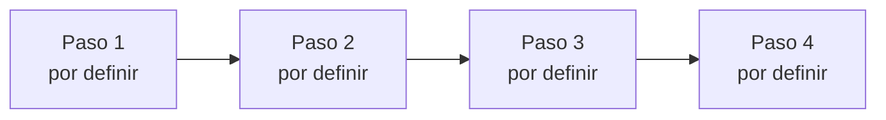
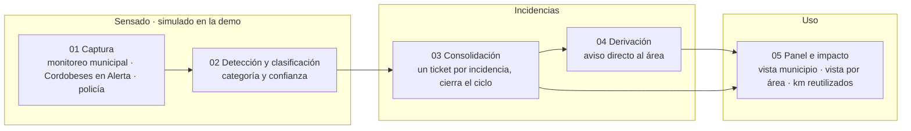

<div align="center">

# Nombre del producto

**Frase en negrita: qué cambia y para quién.**

Tipo de producto · Hack to the Future 2026 · Córdoba Tech Week · Vertical por definir

[](harness/guia-oficial.md)
[](harness/evento.md)
[](harness/ESTADO.md)
<!-- Badges de stack: se agregan cuando el stack quede en el decision log. -->

</div>

---

_El problema en dos o tres frases: qué pasa, a quién le pasa en Córdoba y por qué sigue sin resolverse._

_Qué hace el producto, en una frase._

```text
Ejemplo breve de uso: se completa cuando exista la demo.
```

> [!IMPORTANT]
> _Principio central del producto, en una línea._

> [!NOTE]
> **Estado actual:** esqueleto. El problema y la solución se eligen el 12/11/2026 en el kickoff.
> Hoy el repositorio contiene el harness del equipo y la investigación previa; no hay producto.

---

## Por qué este proyecto

_Por qué tiene sentido en este contexto: Córdoba, la vertical elegida y el ecosistema._

1. _Qué hace, paso 1._
2. _Qué hace, paso 2._
3. _Qué hace, paso 3._

---

## Recorrido de punta a punta



El detalle vive en [`harness/arquitectura/recorrido-usuario.html`](harness/arquitectura/recorrido-usuario.html).

| Superficie | Qué pregunta responde |
|---|---|
| _Por definir_ | _—_ |

---

## Demo objetivo

| Momento | Qué se ve | Qué prueba |
|---|---|---|
| _Por definir_ | _—_ | _—_ |

La secuencia congelada vive en [`harness/demo-path.md`](harness/demo-path.md) y el guion en [`harness/pitch.md`](harness/pitch.md).

---

## Arquitectura objetivo



Borrador del 12/11 15:08, posterior al pivot, sin dueños ni aprobación.

El diagrama completo, con dueños, entradas, salidas y aprobación, vive en
[`harness/arquitectura/solucion.html`](harness/arquitectura/solucion.html).

### Núcleo técnico

_Qué hace el núcleo y por qué así._

### Contrato de confianza

_Qué hace siempre, qué no hace nunca y qué es simulado en la demo._

---

## Dónde está la evidencia

| Afirmación | Implementación | Cómo revisarla |
|---|---|---|
| _Por definir_ | _—_ | _—_ |

---

## Estado del repositorio

| Área | Estado |
|---|---|
| Harness del equipo (reglas, proceso, decisiones) | **Listo** |
| Investigación previa | **Lista** para residuos (cuantitativo y cualitativo); cualitativa para agro, biodiversidad y movilidad |
| Problema y solución | **Pendiente:** se eligen el 12/11 |
| Diagramas de arquitectura | **Borrador:** solución con 5 nodos, sin dueños ni aprobación; recorrido del usuario, plantilla |
| Producto | **No empezado** |

---

## Ejecutar localmente

### Requisitos

_Se completan cuando se elija el stack._

### Comandos

```bash
# Se completa cuando exista código.
```

### Cómo verificar que funciona

_Smoke check del demo path: se completa cuando exista._

---

## API disponible hoy

| Método | Ruta | Propósito |
|---|---|---|
| _—_ | _—_ | _No hay API todavía._ |

---

## Levantar el frontend

Desde la raíz del repo:

```bash
cd frontend
npm ci
npm run dev
```

Vite indica la URL local. [Detalles del prototipo](frontend/README.md)

## Mapa del repositorio

```text
.
├── guia-interfaz-identidad.md Guía para iterar interfaz, landing e identidad visual
├── AGENTS.md                  Reglas para personas y agentes (fuente única)
├── CLAUDE.md                  Importa AGENTS.md para Claude Code
│
├── frontend/                 Prototipo React, mapa y datos simulados
├── harness/
│   ├── guia-oficial.md        Reglas de la organización y cómo las cumplimos
│   ├── ESTADO.md              Tablero vivo: fase, tareas y bloqueos
│   ├── equipo.md              Áreas, responsables y tarjetas para agentes
│   ├── evento.md              Criterios, agenda y checkpoints
│   ├── kickoff.md             Cómo elegimos el problema
│   ├── proceso.md             Ideas, hipótesis, pruebas y resultados
│   ├── decision-log.md        Decisiones con opciones y motivo
│   ├── demo-path.md           Recorrido simulado y demo, paso a paso
│   ├── arquitectura/          Diagramas HTML: solución y recorrido del usuario
│   ├── docs/producto/         Dominio del problema, idea, épicas y solución paso a paso
│   ├── contratos.md           Interfaces entre nodos
│   ├── marca.md               Identidad visual y tono
│   ├── pitch.md               Estructura y preguntas del jurado
│   ├── pitch/              Deck en HTML (estilo TED, marca Ichnos) y speech de 3 minutos
│   └── mentores.md            Notas de mentores, datos y no veredictos
│
└── research/
    ├── Contexto.md            Resumen de la investigación previa
    ├── cuantitativo/          Pipeline de noticias de residuos: reporte y 15 fichas
    └── cualitativo/           Triage por vertical (Gina), mentoría (Oli), Croma y fuentes (Samo)
        └── juani/             Compostaje, fichas de problemas, propuesta de IA y PDF
```

---

## Principios

1. _Principio 1._
2. _Principio 2._
3. _Principio 3._

---

## Equipo

| Integrante | Foco |
|---|---|
| **Samo** | Nexo entre producto y técnica, arquitectura y harness |
| **Lauti** | Técnica: datos, LLM y flujos agénticos |
| **Diego** | Técnica, pensamiento sistémico y hardware |
| **Juani** | Marca, frontend y experiencia visual |
| **Gina** | Producto, estrategia y mentores |
| **Oli** | Producto, mercado, financiamiento y pitch |

Construido en Córdoba para **Hack to the Future 2026**, en la Córdoba Tech Week, organizado por
**Córdoba Cluster** con financiamiento de la **Unión Europea** y el **ITC**.

<div align="center">

### Nombre del producto

*Frase final: se define con el producto.*

</div>
