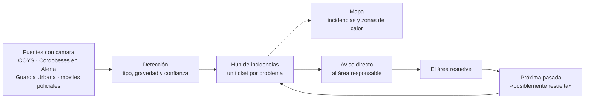
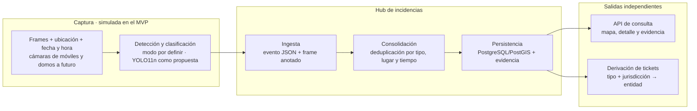

<div align="center">

# Urbis

**Detección urbana desde el patrullaje.**

Visión por computadora para el mantenimiento urbano · Hack to the Future 2026 · Córdoba Tech Week

[](harness/guia-oficial.md)
[](harness/docs/producto/encaje-movilidad-urbana-ue.md)
[](harness/ESTADO.md)
[](frontend/package.json)
[](frontend/package.json)
[](frontend/package.json)
[](frontend/package.json)

Equipo Hackaranda · Mesa 24

</div>

---

Estimamos que unos **5,6 millones de litros de combustible por año** (unos $12.000 millones) mueven el patrullaje de Córdoba: 770 móviles (700 camionetas policiales y 70 de la Guardia Urbana) que recorren la ciudad todo el día con cámaras, pero que solo reportan seguridad. La flota tiene fuente; el consumo de 20 litros por día por móvil es un supuesto (detalle en [`harness/pitch/speech.md`](harness/pitch/speech.md)). Mientras tanto, la basura se acumula en las esquinas hasta que un vecino reclama, y en una sola tormenta Defensa Civil recibió **198 llamados** por postes o columnas caídos o en riesgo (Perfil, 7/8/2026). Hoy la ciudad se entera tarde de lo que se rompe o se acumula, y casi siempre por el vecino.

**Urbis convierte los recorridos que la ciudad ya hace en detección de incidencias urbanas:** reúne las observaciones de cada cámara en un ticket por problema, avisa directo al área que lo resuelve y lo muestra en un mapa.

```text
Un móvil pasa por una esquina de Córdoba.
  → La cámara detecta un contenedor rebalsado.
  → Se arma un ticket con ubicación, gravedad y evidencia.
  → El aviso llega directo a Higiene urbana, sin que nadie lo reenvíe.
  → Otra pasada lo vuelve a ver: el ticket suma un avistamiento.
  → Una pasada posterior ya no lo detecta: queda «posiblemente resuelta».
```

> [!IMPORTANT]
> **Mismo recorrido, más sustentabilidad.** Urbis no suma vehículos, cámaras ni kilómetros: le da más usos a la flota que ya circula.

> [!NOTE]
> **Estado actual (12/11/2026 22:45):** hay un prototipo frontend con 194 tickets **simulados**, un deck de 9 slides y el registro del proceso. No hay backend, API ni detección real. La arquitectura técnica está en iteración en la rama [`architecture/init`](https://github.com/NachoSamo/Hack2theFuture-CordobaTechWeek/blob/architecture/init/harness/arquitectura/arquitectura-sistema.md), todavía sin mergear ni aprobar.

---

## Por qué este proyecto

Es un problema de **movilidad**: el recurso que se optimiza es la flota. Cada kilómetro que ya se recorre pasa a servir a más de un fin, y ningún área tiene que sacar otro vehículo a la calle para buscar el problema ([decision log, 12/11 19:40](harness/decision-log.md)). Encaja con el marco de movilidad urbana de la Unión Europea, que pide a las ciudades medir y usar soluciones digitales ([encaje con la UE](harness/docs/producto/encaje-movilidad-urbana-ue.md)), y con Córdoba en particular: la UE ya apoyó con **600.000 €** de asistencia técnica el Plan de Movilidad Urbana Sostenible de la ciudad, que prevé un Observatorio de Movilidad ([MobiliseYourCity, 14/10/2025](https://www.mobiliseyourcity.net/cordobas-sustainable-urban-mobility-plan-paves-way-integrated-metropolitan-transport-system)).

Qué hace Urbis:

1. **Detecta** incidencias en las imágenes de los vehículos que ya circulan: residuos, baches, luminarias, ramas y cables caídos.
2. **Consolida** las observaciones de varias pasadas y fuentes en una sola incidencia, sin duplicados.
3. **Deriva** un ticket directo al área responsable, sin una persona en el medio.
4. **Muestra** las incidencias en un mapa, con zonas de calor de atención y cobertura.
5. **Verifica** con la próxima pasada: si ya no lo ve, la incidencia queda «posiblemente resuelta».

---

## Recorrido de punta a punta



| Superficie | Qué pregunta responde |
|---|---|
| Landing ([`frontend/`](frontend/README.md)) | ¿Qué es Urbis y cómo se ve una detección? |
| Mapa de incidencias (`/#mapa`) | ¿Qué está pasando en la ciudad y dónde? |
| Zonas de calor | ¿Dónde hay más incidencias y qué parte de la ciudad no está observada? |
| Tarjeta del ticket | ¿Qué se detectó, con qué gravedad, quién lo resuelve y qué pasó hasta ahora? |
| Acciones del ticket | ¿Qué hago ahora: aviso manual, ruta sugerida o plan de barrida? |
| [Deck](harness/pitch/deck.html) y [speech](harness/pitch/speech.md) | ¿Cómo lo contamos en 3 minutos? |
| [Mural de lienzos](harness/proceso/mural-mesa24.html) | ¿Cómo llegamos a esta solución y qué decidimos en el camino? |

---

## Demo

| Momento | Qué se ve | Qué prueba |
|---|---|---|
| Pitch · video de la landing | Detecciones simuladas con la cámara: bache, rama caída y contenedor rebalsado, cada una con su ticket y su acción | Que una cámara en movimiento puede convertir lo que ve en un ticket accionable |
| Prototipo · entrada | `/#mapa` abre el mapa 3D de Córdoba con 194 tickets simulados | Que el municipio ve toda la ciudad en un solo lugar |
| Prototipo · secuencia automática | Se publica un ticket, otra pasada suma un avistamiento, sale el aviso y una pasada de verificación lo deja «posiblemente resuelto» | El ciclo completo, sin intervención humana |
| Prototipo · tarjeta | Tipo, foto ilustrativa, gravedad, área responsable, historial automático o manual y próximo paso | Que el área recibe lo que necesita para actuar |
| Prototipo · acciones | Aviso manual, ruta sugerida para el contenedor y plan de barrida para residuos o ramas | Que el ticket termina en una acción concreta |
| Prototipo · zonas de calor | Rojo con tickets activos, verde observado sin tickets y gris sin observación | Atención y cobertura de la ciudad |

`/#mapa/deteccion` abre directo el ticket CBA-104, el contenedor que aparece en el video. La secuencia exacta vive en [`harness/demo-path.md`](harness/demo-path.md).

---

## Arquitectura objetivo

Resumen de la versión en iteración de [`arquitectura-sistema.md`](https://github.com/NachoSamo/Hack2theFuture-CordobaTechWeek/blob/architecture/init/harness/arquitectura/arquitectura-sistema.md) (rama `architecture/init`, 12/11 22:09). Nada de esto está implementado todavía.



### Núcleo técnico

El centro es un **hub de incidencias**: recibe eventos de detección, los consolida en una incidencia por problema y alimenta dos salidas que no dependen entre sí, la API para el mapa y la derivación de tickets. La rama define cuatro contratos: **evento** (fuente → hub), **incidencia** (hub → API), **ticket** (hub → entidad) y **evidencia visual** (el frame con el recuadro de la detección). La gravedad usa cuatro niveles (bajo, medio, alto y extremo). YOLO11n con ONNX Runtime o TensorRT, el umbral de confianza de 0,65 y el radio de deduplicación de 15–20 m con ventana de 6 horas son **valores de referencia**, no decisiones validadas.

### Contrato de confianza

- **Siempre simulado en el MVP:** la captura, las detecciones, los 194 tickets, la cobertura y las coordenadas agregadas. Las fotos son ilustrativas y se reutilizan por tipo de incidencia.
- **Nunca video:** se envían solo los frames asociados a una detección.
- **Privacidad (propuesta):** pixelar caras y patentes antes de enviar el frame. La rama hoy envía el frame sin pixelar; queda como decisión pendiente para la arquitectura ([decision log, 12/11 22:45](harness/decision-log.md)).
- **«Posiblemente resuelta» no es «resuelta»:** que una pasada no vuelva a detectar un problema no prueba que se haya resuelto.
- **Una luminaria detectada es un indicio visual**, no la confirmación de la causa.
- **Cifras de impacto sin medir:** el aprovechamiento de la flota (km con Urbis activo ÷ km totales) y el ahorro del municipio son lo que mide el piloto.
- **Decisiones abiertas en la rama:** pasadas, gravedad, consolidación, estados, transporte (HTTPS o MQTT), derivación, modo de detección del MVP, consultas, verificación y evidencia visual.

---

## Dónde está la evidencia

| Afirmación | Implementación | Cómo revisarla |
|---|---|---|
| El prototipo muestra 194 tickets simulados en un mapa 3D de Córdoba | [`frontend/src/tickets-mock.json`](frontend/src/tickets-mock.json), [`CityMap.tsx`](frontend/src/CityMap.tsx) | Correr el frontend y abrir `/#mapa` |
| La gravedad tiene cuatro niveles | [`frontend/src/tickets.ts`](frontend/src/tickets.ts) (`severityLabels`) | Filtrar o abrir tickets de distinta gravedad |
| El ciclo ticket → avistamiento → aviso → verificación corre solo | [`frontend/src/main.tsx`](frontend/src/main.tsx) | Recargar `/#mapa` y mirar la secuencia |
| El ticket sigue el payload de la arquitectura | [`tickets-mock.json`](frontend/src/tickets-mock.json) y [`arquitectura-sistema.md`](harness/arquitectura/arquitectura-sistema.md) | Comparar los campos del mock con la sección 3.3 |
| Las cifras del pitch tienen fuente | [`harness/pitch/speech.md`](harness/pitch/speech.md), sección «Para los ensayos» | Revisar la fuente de cada cifra |
| El proceso de Design Thinking quedó registrado | [`harness/proceso/mural-mesa24.html`](harness/proceso/mural-mesa24.html), [`fotos/`](harness/proceso/fotos/), [`proceso.md`](harness/proceso.md) | Abrir el mural en el navegador |
| Cada decisión tiene sus opciones y su motivo | [`harness/decision-log.md`](harness/decision-log.md) | Filtrar las filas `core` |

---

## Estado del repositorio

| Área | Estado |
|---|---|
| Prototipo frontend (landing, mapa, tarjetas, acciones, zonas de calor) | ✅ **Funciona**, con datos simulados |
| Backend, hub y API | ⬜ **Planeados** en la arquitectura; sin código |
| Detección por visión por computadora | ⬜ **Por definir**: modelo real o resultados precargados |
| Arquitectura técnica | 🟡 **En revisión** en la rama `architecture/init` |
| Diagramas y contratos ([`arquitectura/`](harness/arquitectura/README.md), [`contratos.md`](harness/contratos.md)) | 🟡 **Borrador**, sin aprobar |
| Pitch | ✅ Deck de 9 slides y speech v10 para dos voces |
| Proceso registrado (mural, decision log, proceso, mentores) | ✅ **Al día** al 12/11 22:45 |
| Harness del equipo | ✅ **Listo** |

---

## Ejecutar localmente

### Requisitos

- Node.js 22 (probado con 22.17) y npm.
- Un navegador con WebGL para el mapa 3D. Si falla OpenFreeMap, los marcadores siguen sobre un fondo neutro.

### Comandos

```bash
cd frontend
npm ci
npm run dev
```

Para compilar:

```bash
npm run build
```

### Cómo verificar que funciona

1. Vite muestra una URL local (`http://127.0.0.1:5173` por defecto): la landing reproduce los clips de detección.
2. `/#mapa` abre el mapa 3D con los tickets. La secuencia automática arranca sola y recargar la reinicia.
3. Un marcador abre su tarjeta sobre el mapa; se cierra con Escape.

El detalle del prototipo está en [`frontend/README.md`](frontend/README.md).

---

## API disponible hoy

No hay API: el prototipo lee datos simulados locales. La arquitectura en revisión **planea** estas rutas, que todavía no existen:

| Método | Ruta | Propósito |
|---|---|---|
| `POST` | `/api/v1/telemetry/events` | Planeada: ingesta de eventos de detección |
| `GET` | `/api/v1/analytics/heatmap` | Planeada: GeoJSON para el mapa de calor, con filtros de categoría, gravedad y fechas |

---

## Mapa del repositorio

```text
.
├── README.md
├── AGENTS.md                    Reglas para personas y agentes (fuente única)
├── CLAUDE.md                    Importa AGENTS.md para Claude Code
├── guia-interfaz-identidad.md   Contenido de la landing, vistas del MVP e identidad
│
├── frontend/                    Prototipo React + Vite + MapLibre
│   ├── public/                  Logo, clips de detección y fotos ilustrativas de tickets
│   ├── scripts/                 Generación de rutas con OSRM
│   └── src/                     App, mapa, tickets y datos simulados
│
├── harness/
│   ├── ESTADO.md                Tablero vivo: fase, tareas, avisos y bloqueos
│   ├── equipo.md                Áreas, responsables y tarjetas para agentes
│   ├── guia-oficial.md          Reglas de la organización y cómo las cumplimos
│   ├── evento.md                Criterios, agenda y checkpoints
│   ├── kickoff.md               Cómo elegimos el problema
│   ├── decision-log.md          Decisiones con opciones y motivo
│   ├── proceso.md               Ideas, hipótesis, pruebas y resultados
│   ├── proceso/                 Mural HTML con los 16 lienzos y fotos de los papeles del día 1
│   ├── mentores.md              Lo que dijeron mentores, expertos y el test 3+3
│   ├── docs/producto/           Dominio del problema, idea y épicas, solución paso a paso, encaje UE
│   ├── arquitectura/            Arquitectura del sistema y diagramas HTML de solución y recorrido
│   ├── contratos.md             Interfaces entre nodos
│   ├── demo-path.md             Secuencia de la demo y fallbacks
│   ├── marca.md · marca/        Identidad de Urbis, logo, referencias y prototipos anteriores
│   └── pitch.md · pitch/        Estructura del pitch, deck HTML, imágenes y speech
│
└── research/
    ├── Contexto.md              Resumen de la investigación previa y hasta dónde confiar
    ├── cuantitativo/            Pipeline de noticias de residuos: reporte y 15 fichas
    └── cualitativo/             Triage por vertical, entrevistas, mentorías y financiamiento
```

---

## Principios

1. **Aprovechar lo que ya existe.**
2. **Escuchar y pivotar.**
3. **Medir, no estimar.**
4. **Decide quien hace.**
5. **El repo es la única fuente de verdad.**

---

## Equipo

| Integrante | Foco |
|---|---|
| **Samo** | Nexo entre producto y técnica, arquitectura y harness |
| **Lauti** | Técnica: datos, LLM y flujos agénticos |
| **Diego** | Técnica, pensamiento sistémico y hardware |
| **Juani** | Marca, frontend y experiencia visual |
| **Gina** | Producto, estrategia, mentores y jurado |
| **Oli** | Producto, mercado, financiamiento y pitch |

Construido en Córdoba durante **Hack to the Future 2026** (12 y 13 de noviembre), en la Córdoba Tech Week, organizado por **Córdoba Cluster** con **Global Gateway** de la Unión Europea y el **ITC**, para la vertical de movilidad sostenible.

---

<div align="center">

### Urbis

*Ciudades que se autosanen.*

</div>
