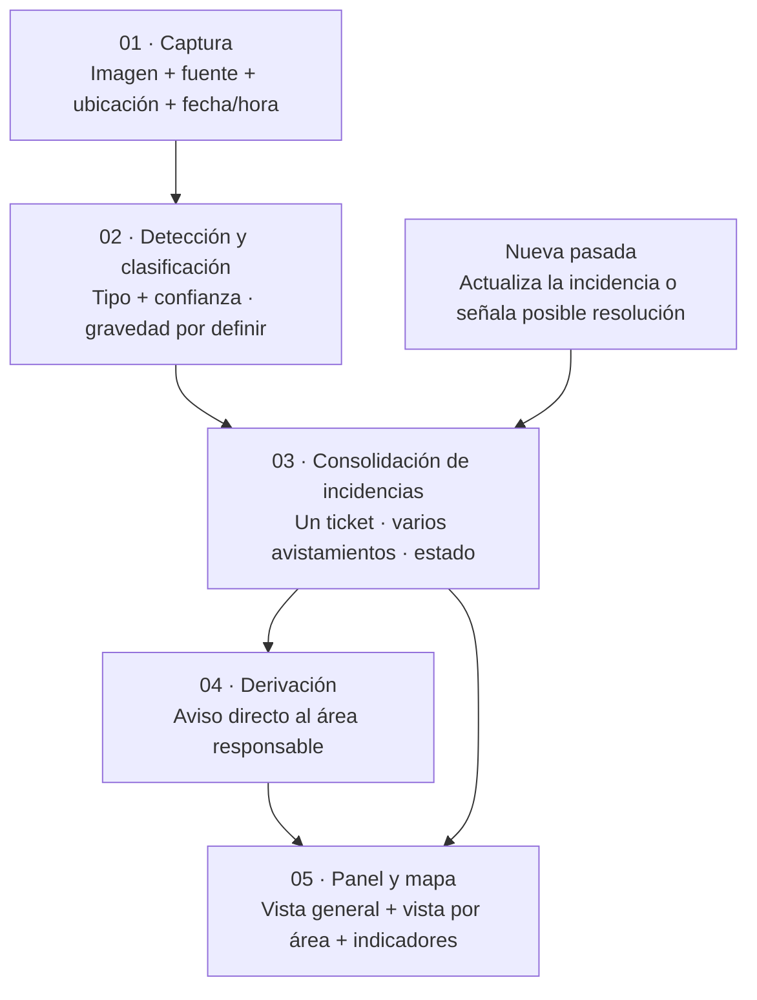

# Trama Urbana

**Un móvil para autosanar la ciudad.**

Propuesta de producto · Hack to the Future 2026 · Córdoba Tech Week · Movilidad y mantenimiento urbano

> Guía para iterar la landing y proponer el MVP. Actualización: **12/11/2026**, sesión con Diego y Lauti.
> **Trama Urbana** es el nombre propuesto en [marca](harness/marca.md), todavía para revisión.
> El flujo de producto está definido como objetivo; su implementación completa sigue pendiente.

## El producto

Aprovechar las imágenes de cámaras y los recorridos que ya existen para **detectar problemas urbanos, reunirlos en incidencias, avisar al área responsable y mostrarlos en un mapa**.

El alcance incluye residuos, contenedores y mantenimiento de la vía pública. Cada entidad ve el trabajo que le corresponde; la vista general permite observar lo que está pasando en la ciudad.

**Valor buscado:** obtener más información útil de la infraestructura existente, sin agregar vehículos ni recorridos de relevamiento. El acceso a las fuentes y el beneficio operativo todavía deben validarse.

## Qué está consolidado y qué sigue abierto

| Tema | Definición para trabajar la interfaz | Estado |
|---|---|---|
| Alcance | Detección de problemas municipales; residuos es una categoría entre varias | Registrado en producto y decision log |
| Fuentes móviles | Vehículos con cámara: COYS, Cordobeses en Alerta y móviles policiales | Fuentes contempladas; acceso sin validar |
| Domos | Incorporar también cámaras fijas | Planteado por Diego y Lauti; pendiente alinear con arquitectura |
| Clasificación | Identificar tipo de problema y confianza de la detección | Definido como objetivo; modelo sin elegir |
| Gravedad | Bajo, medio, alto y extremo | Escala planteada por Diego y Lauti; criterios por categoría pendientes |
| Incidencias | Reunir observaciones del mismo problema en un ticket | Consolidado; reglas de agrupación pendientes |
| Derivación | Aviso directo al área responsable; COYS tiene vista general y no asigna | Decisión registrada por Samo |
| Mapa | Vista general y vista de incidencias por área | Consolidado; mapa de calor solicitado, todavía sin implementar |
| Seguimiento | Una pasada posterior puede marcar «posiblemente resuelta» | Decisión registrada; umbrales pendientes |
| Rutas | El mapa puede alimentar la planificación de cada entidad | Extensión planteada; el MVP de producto registrado no rediseña rutas de recolección |

Fuentes: [decisiones](harness/decision-log.md), [idea y épicas](harness/docs/producto/idea-y-epicas.md) y [paso a paso](harness/docs/producto/solucion-paso-a-paso.md). La revisión del flujo en esta sesión aporta propuestas, no aprobaciones de arquitectura.

## Flujo del producto



**El ticket y el mapa representan la misma incidencia.** Una nueva observación actualiza ese problema; no debería multiplicar los avisos por cada frame.

| Etapa | Qué ocurre | Qué debería poder mostrar la interfaz |
|---|---|---|
| Captura | Se recibe una imagen con sus datos de origen | Fuente, lugar y momento de la observación |
| Clasificación | Se identifica un posible problema | Categoría, confianza y gravedad cuando se acuerden sus criterios |
| Consolidación | Se reúnen observaciones del mismo problema | Ticket, avistamientos, primera y última observación |
| Derivación | Se identifica el área y se genera el aviso | Destinatario y estado del aviso; canal todavía por definir |
| Panel y mapa | Cada usuario consulta las incidencias que le corresponden | Ubicación, categoría y estado; vista general o por área |
| Seguimiento | Una nueva pasada aporta evidencia | Evolución del ticket y estado «posiblemente resuelta» |

La arquitectura continúa en **borrador**, con dueños y contratos por completar: [diagrama](harness/arquitectura/solucion.html) · [contratos](harness/contratos.md).

## Categorías del producto

| Grupo | Ejemplos contemplados | Límite para comunicarlo |
|---|---|---|
| Residuos y voluminosos | Microbasurales, bolsas acumuladas, escombros, ramas y colchones | La detección y la magnitud deben validarse con imágenes |
| Contenedores | Llenos, rebalsados o rotos | Son estados distintos; no tratarlos como equivalentes |
| Vía pública | Baches, postes o cables caídos, señales y semáforos | La imagen aporta un indicio; la gravedad requiere criterios específicos |
| Alumbrado y otros problemas propuestos | Luminarias apagadas, árboles caídos, posibles cortes de luz | Incorporación y evidencia a validar; una imagen oscura no confirma un corte eléctrico |

**Tipo, gravedad y confianza son datos diferentes.** La confianza expresa la certeza de la detección; la gravedad expresa las consecuencias del problema. La escala bajo / medio / alto / extremo todavía no tiene reglas acordadas.

## Guía para iterar la landing

Estas son piezas de contenido para probar; el orden visual y las acciones de la landing quedan a cargo de Juani y producto.

| Pieza | Contenido disponible | Qué mostrar o aclarar |
|---|---|---|
| Presentación | Nombre propuesto: **Trama Urbana**. Título registrado: **«Un móvil para autosanar la ciudad.»** | Detección de problemas urbanos desde infraestructura existente |
| Problema | Información de cámaras que podría servir también al mantenimiento de la ciudad | El uso actual de las fuentes y la demora en detectar problemas son hipótesis por validar |
| Cómo funciona | Captura → clasificación → consolidación → derivación → panel | El diagrama de este README; evitar centrar todo el relato en basura |
| Producto en uso | Mapa, lista de incidencias y detalle de un caso | Identificar claramente «Datos simulados» |
| Para quién | Áreas que resuelven y vista general de COYS | Cada área consulta sus tickets; COYS no funciona como asignador |
| Valor | Más usos de las cámaras y recorridos existentes | Mostrar el mecanismo sin inventar ahorros ni resultados de un piloto |
| Alcance del MVP | Recorrido propuesto en la sección siguiente | Diferenciar propuesta, prototipo existente e integración real |

**Marca disponible:** [logo](harness/marca/logo.svg), paleta y tipografías en [marca](harness/marca.md). Ese documento conserva descriptor, misión y slogan centrados en recolección; su adaptación al alcance municipal está pendiente con Juani. No tomarlos como copy consolidado para la nueva landing.

## MVP propuesto para revisar con el equipo

Basado en las épicas existentes. **No es un alcance aprobado ni reemplaza el [demo path](harness/demo-path.md)**, que todavía debe completarse.

| Momento | Qué se muestra | Qué permite poner a prueba |
|---|---|---|
| 1 · Observación | Frame o entrada grabada con ubicación, fecha/hora y fuente | Que la procedencia y el lugar se entienden |
| 2 · Detección | Problema identificado y su categoría | Que el resultado es comprensible y útil |
| 3 · Incidencia | Varias observaciones reunidas en un ticket | Que se entiende la diferencia entre avistamiento y problema |
| 4 · Derivación | Área destinataria y aviso simulado | Que el destinatario recibe información suficiente para actuar |
| 5 · Mapa | Vista general y vista del área con sus incidencias | Que se puede localizar el trabajo pendiente |
| 6 · Seguimiento | Una nueva pasada actualiza el caso a «posiblemente resuelta» | Que se entiende el seguimiento y su incertidumbre |

Las distintas categorías deben poder recorrer el mismo flujo. Las entradas, avisos y resultados precargados deben identificarse como **simulados**. Si falla el modelo, la demo necesita una respuesta determinística con los mismos datos.

**Pendientes para congelar el MVP:** categorías que se demostrarán, datos de entrada, vista inicial, criterios de gravedad, reglas de consolidación y posible resolución, áreas destinatarias, canal del aviso y responsables de nodo. La generación de rutas queda como extensión; el mapa entrega los puntos para que cada entidad planifique según su operación.

## Estado real del repositorio

| Parte | Disponible |
|---|---|
| Frontend | Prototipo React con mapa, lista de eventos y detalle seleccionable sobre datos simulados |
| Recorridos del prototipo | Ruta fija y desvío sugerido precalculado por evento; conserva un enfoque de recolección que requiere revisión frente al alcance ampliado |
| Niveles del prototipo | Baja, media y alta; **extremo no está implementado** |
| Detección por IA | Sin integración en el frontend revisado |
| Tickets y derivación | Flujo documentado; sin API ni integración real implementada |
| Panel por área y mapa de calor | Objetivos de producto; sin implementar en el prototipo revisado |
| Marca | Nombre, logo y sistema visual propuestos; textos parcialmente anteriores al pivot |
| Arquitectura y contratos | Borrador; sin contratos JSON ni aprobación completa |
| Validación e impacto | Hipótesis pendientes; sin resultados medidos de un piloto |

Referencias verificables: [frontend](frontend/README.md), [interfaz actual](frontend/src/main.tsx), [modelo actual](frontend/src/model.ts), [escenario simulado](frontend/src/mock.json), [proceso](harness/proceso.md).

## Límites que deben quedar claros

- **Reutilizar infraestructura no prueba costo marginal cero.** Procesamiento, conectividad, integración y revisión siguen pendientes de estimación.
- **Kilómetros reutilizados no equivalen a emisiones evitadas.** El ahorro requiere demostrar recorridos efectivamente evitados; las cifras de simulación se etiquetan como tales.
- **Sin dato no significa sin problema.** La cobertura depende de dónde y cuándo observan las cámaras.
- **«Posiblemente resuelta» no confirma una reparación.** Los criterios de observación y verificación siguen abiertos.
- **Ubicación de cámara y ubicación del problema pueden diferir.** La precisión necesaria debe definirse antes de prometer una ubicación exacta.
- **Privacidad:** se busca conservar solo información del problema, sin personas ni patentes. Procesamiento, acceso a frames y retención requieren definición; no presentarlos como controles ya implementados.
- Las fuentes y entidades mencionadas son actores contemplados, no integraciones ni acuerdos confirmados. El destinatario concreto depende también de la jurisdicción.

## Ejecutar localmente

Requisitos: Node.js y npm compatibles con las dependencias de [frontend/package.json](frontend/package.json). El repositorio no fija una versión de Node.

```bash
cd frontend
npm ci
npm run dev
```

Vite indica la dirección local. Para compilar:

```bash
npm run build
```

El mapa usa cartografía externa; el feed permanece disponible si falla. Los recorridos se leen de un archivo precalculado. Más detalles en [frontend/README.md](frontend/README.md).

**Verificación manual del prototipo existente:** abrirlo, seleccionar un evento, comprobar su detalle y desvío, y cerrar el detalle para volver a la ruta fija. Este recorrido no verifica el MVP completo de tickets.

## API disponible hoy

No hay endpoints de producto implementados ni integraciones confirmadas con entidades. Los contratos se acordarán en [harness/contratos.md](harness/contratos.md).

## Mapa del repositorio

```text
.
├── README.md                  Producto, flujo y guía para landing/MVP
├── AGENTS.md                  Reglas del equipo
├── CLAUDE.md                   Importa AGENTS.md
├── frontend/                  Prototipo React con datos simulados
├── hack/                      Carpeta de Obsidian incorporada por el equipo
├── harness/
│   ├── ESTADO.md              Tareas, avisos y bloqueos
│   ├── decision-log.md        Decisiones y sus motivos
│   ├── proceso.md             Ideas, hipótesis y pruebas
│   ├── docs/producto/         Dominio, idea, épicas y paso a paso
│   ├── arquitectura/          Diagramas y aprobaciones
│   ├── contratos.md           Interfaces pendientes de concretar
│   ├── demo-path.md           Secuencia de demo por completar
│   ├── marca.md               Propuesta de identidad
│   ├── marca/                 Logo, prototipos y referencias visuales
│   ├── pitch.md               Estructura del pitch
│   ├── pitch/                 Deck y speech
│   ├── equipo.md              Responsables
│   ├── mentores.md            Registro de mentorías
│   ├── guia-oficial.md        Reglas y agenda oficiales
│   ├── evento.md              Criterios y checkpoints
│   └── kickoff.md             Método para elegir el problema
└── research/                  Investigación previa; leer Contexto.md
```

## Equipo

| Integrante | Foco |
|---|---|
| Samo | Nexo entre producto y técnica, arquitectura y harness |
| Lauti | Técnica: datos, LLM y flujos agénticos |
| Diego | Técnica, pensamiento sistémico y hardware |
| Juani | Marca, frontend y experiencia visual |
| Gina | Producto, estrategia y mentores |
| Oli | Producto, mercado, financiamiento y pitch |

[Estado del equipo](harness/ESTADO.md) · [Investigación y límites](research/Contexto.md) · [Reglas del evento](harness/guia-oficial.md)
