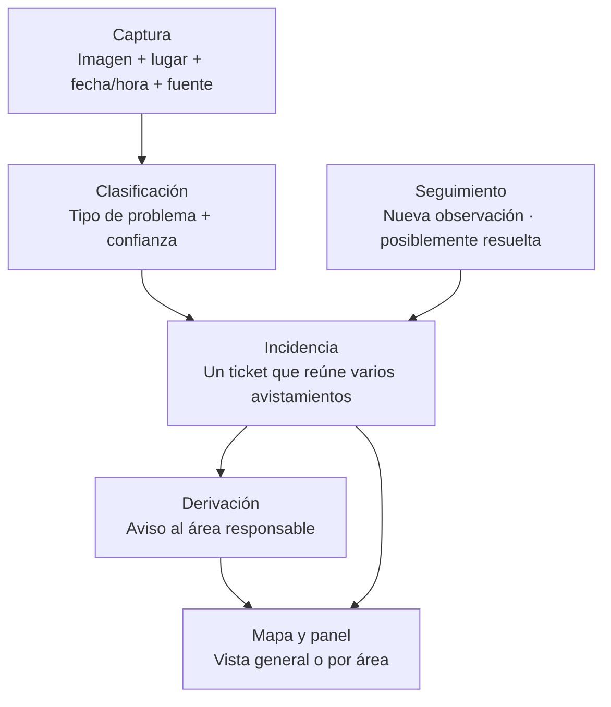

# Ichnos · Guía de interfaz e identidad visual

**Documento de trabajo para Juani · Sesión con Diego y Lauti · 12/11/2026**

Objetivo: dar contexto suficiente para **iterar la landing y mostrar una propuesta visual de MVP**. Reúne lo definido del producto y la identidad disponible; las pantallas sugeridas son una propuesta para revisar, no un diseño aprobado.

## 1. Qué tiene que entender quien ve el producto

Ichnos propone aprovechar las cámaras y los recorridos existentes para **detectar problemas municipales, reunir las observaciones en incidencias, avisar al área responsable y mostrar su ubicación en un mapa**.

- **Problemas:** residuos acumulados, contenedores rebalsados o rotos, baches, postes o cables caídos y otras necesidades de mantenimiento urbano.
- **Usuarios:** áreas que atienden las incidencias y una vista general para COYS. El aviso va directo al área; COYS no asigna.
- **Fuentes contempladas:** cámaras de vehículos de COYS, Cordobeses en Alerta y móviles policiales. Los domos fueron sumados al planteo de Diego y Lauti; falta alinearlos con arquitectura.
- **Valor buscado:** obtener más utilidad de la infraestructura existente, sin agregar recorridos de relevamiento. El acceso a las fuentes y el ahorro todavía deben validarse.

La landing debe comunicar **mantenimiento urbano**, no presentar el producto únicamente como recolección de basura.

## 2. Flujo que la interfaz debe hacer visible

**La imagen es una observación; el ticket representa el problema.** Ver el mismo bache en varios frames debería actualizar una incidencia, no producir varios tickets independientes.

## 3. Contenido para la landing

Piezas para explorar visualmente. Su orden, composición y acciones quedan por revisar con Juani y producto.

| Pieza | Contenido disponible | Qué debe quedar claro |
|---|---|---|
| Presentación | Nombre: **Ichnos**. Slogan: **«De la huella a la acción.»** | Qué hace el producto y para quién |
| Problema | La información que ya capturan las cámaras podría ayudar a detectar necesidades de mantenimiento | Las condiciones actuales del municipio y el uso exclusivo para seguridad siguen siendo hipótesis |
| Funcionamiento | Captura → clasificación → incidencia → derivación → mapa | El recorrido completo, sin explicar herramientas ni APIs |
| Vista del producto | Mapa con incidencias, listado y detalle de un caso | Identificar expresamente los datos simulados |
| Destinatarios | Área que resuelve y vista general de COYS | Una misma base de incidencias con vistas según responsabilidad |
| Valor | Reutilización de cámaras y recorridos; detección y seguimiento | Beneficio propuesto, sin cifras de ahorro inventadas |
| Propuesta de MVP | Recorrido visual de la sección siguiente | Qué se puede demostrar y qué sigue pendiente |

**Acción principal de la landing:** «Explorar el mapa» lleva al prototipo de Córdoba. La portada reúne el slogan, una descripción breve y el video de detección. Las referencias de composición fueron [Linear](https://linear.app/) y [Mapbox](https://www.mapbox.com/).

## 4. Vistas propuestas para mostrar el MVP

| Vista o componente | Información relevante | Qué permite demostrar |
|---|---|---|
| **Mapa general + listado** | Incidencias por ubicación, categoría y estado | Comprender qué está pasando y dónde |
| **Detalle de incidencia** | Tipo, lugar, primera y última observación, avistamientos, confianza y área destinataria | Entender el problema y la evidencia que lo sostiene |
| **Evidencia visual** | Frame o recorte del problema, fecha/hora y fuente | Vincular la detección con una observación; uso y protección de imágenes pendientes de definir |
| **Vista por área** | Los tickets que corresponden a esa entidad | Entender la derivación sin mezclar trabajo de otras áreas |
| **Seguimiento** | Nuevas observaciones y estado «posiblemente resuelta» | Ver cómo evoluciona una incidencia |
| **Demanda por zona** | Concentración de incidencias de una categoría o entidad | Explorar el mapa de calor solicitado, todavía sin implementar |

**Recorrido visual para probar:** observar una detección → abrir su incidencia → identificar el área destinataria → localizarla en la vista del área → mostrar una actualización posterior. La vista inicial y los controles concretos siguen abiertos.

El mapa puede alimentar la planificación de cada entidad. La generación de rutas es una extensión; no debe aparecer como una capacidad confirmada del MVP municipal.

## 5. Qué datos no se deben confundir visualmente

| Dato | Significado | Estado |
|---|---|---|
| Categoría | Qué tipo de problema se detectó | Definida como parte del producto |
| Magnitud observable | Tamaño, cantidad o extensión que se aprecia | Criterios pendientes; no implica medidas físicas exactas |
| Gravedad | Consecuencias del problema | Diego y Lauti plantearon **bajo / medio / alto / extremo**; faltan criterios por categoría |
| Confianza | Certeza de la detección | Independiente de la gravedad; el prototipo ya la muestra |
| Estado de incidencia | Evolución del problema | El producto contempla «posiblemente resuelta»; no equivale a reparación confirmada |
| Estado del aviso | Situación de la derivación | Canal y confirmación de recepción por definir; un envío simulado no es una integración real |
| Cobertura | Dónde y cuándo hubo observación | **Sin dato no significa sin problema** |

El prototipo actual usa tres niveles: baja, media y alta. **Extremo todavía no tiene implementación ni color acordado.** No usar el porcentaje de confianza como sustituto del nivel de gravedad.

## 6. Identidad visual disponible

Fuente: [documento de marca](harness/marca.md), de Juani, **propuesta para revisión**. Esta guía no cambia la identidad.

- **Nombre:** Ichnos.
- **Logo:** [símbolo existente](harness/marca/logo.svg), una esquina urbana atravesada por una ruta lima. Copia usada por el prototipo: [logo del frontend](frontend/public/logo.svg).
- **Tipografías:** Barlow para títulos e interfaz; IBM Plex Mono para horas y datos compactos.
- **Tono:** directo y operativo. Mostrar el problema, su lugar y su estado con términos comprensibles.
- **Accesibilidad visual ya indicada en marca:** acompañar colores con etiquetas y leyenda; escribir el nivel y el estado, sin depender únicamente del color.

| Color existente | HEX | Uso registrado en marca |
|---|---|---|
| Asfalto | `#11191C` | Fondo general y base del símbolo |
| Pizarra | `#19252B` | Paneles superpuestos |
| Niebla | `#EAF0F0` | Texto principal |
| Lima | `#DFF691` | Acción principal, selección y símbolo |
| Terracota | `#BD472D` | Punto crítico |
| Ámbar | `#D79939` | Demanda alta |
| Oliva | `#B2A638` | Demanda media |
| Verde | `#428571` | Demanda baja |
| Gris cartográfico | `#A5B3A9` | Zona sin dato |

La paleta procede de la propuesta anterior de recolección. **Su correspondencia con los cuatro niveles de gravedad municipales sigue pendiente:** punto crítico, demanda alta y gravedad extrema no tienen una equivalencia acordada.

### Mensaje de marca

**Visión por computadora para el mantenimiento urbano.** El slogan **«De la huella a la acción»** conecta la observación en la calle con el ticket y el aviso al responsable.

## 7. Qué puede reutilizarse del prototipo

| Disponible | Adaptación pendiente para esta propuesta |
|---|---|
| Mapa, listado de eventos y detalle seleccionable | Pasar del relato de recolección al de incidencias municipales |
| Categoría, ubicación, hora, nivel y confianza | Diferenciar incidencia, avistamientos, gravedad y estado |
| Marca, logo y referencias visuales | Revisar descriptor, slogan y correspondencia de colores |
| Ruta fija y desvío precalculado por evento | No usarlos como prueba de un planificador municipal implementado |
| Datos simulados identificados en pantalla | Mantener esa identificación en capturas y demostraciones |

**Pendientes en el prototipo de recolección que revisó esta guía:** detección por IA integrada, tickets y derivación real, selector de área, seguimiento de resolución, mapa de calor y cuarto nivel de gravedad.

Referencia: [frontend actual](frontend/README.md) · [referencias visuales de Juani](harness/marca/referencias/README.md).

**Iteración posterior del prototipo:** la vista COYS muestra marcadores, filtros por tipo, estado y área en la barra del mapa, un panel que se abre al seleccionar un ticket con foto ilustrativa e historial y mapa 3D con una vista de zonas de calor y rutas accesibles desde los tickets activos de contenedor rebalsado. La altura y las entrecalles de ejemplo se cargan desde el mock. Al abrir el mapa de incidencias, el fixture publica automáticamente un ticket y actualiza su historial con avistamientos, aviso y verificación posterior. Los avisos y avistamientos de la simulación se generan en el frontend. [Cómo probarlo](frontend/README.md).

## 8. Límites del mensaje y decisiones pendientes

- **Costo marginal cero:** hipótesis, no resultado medido. Se reutiliza infraestructura, pero falta estimar procesamiento, conectividad, integración y revisión.
- **Impacto ambiental:** kilómetros reutilizados no equivalen a emisiones evitadas. No presentar ahorros sin una medición o sin identificar los supuestos de simulación.
- **Detección:** una luminaria apagada o una imagen oscura no confirman por sí solas un corte eléctrico. La ubicación del vehículo tampoco garantiza la ubicación exacta del problema.
- **Seguimiento:** «posiblemente resuelta» expresa incertidumbre; no mostrarlo como reparación verificada.
- **Privacidad:** acceso a frames, ocultamiento de personas y patentes, y retención son requisitos por concretar, no controles implementados.

Para cerrar la propuesta visual faltan: categorías que se demostrarán, vista inicial, criterios y colores de los cuatro niveles, datos visibles del ticket, tratamiento de la evidencia y acción principal de la landing. El alcance y las pantallas se revisan con el equipo antes de congelar el MVP.

[Idea y épicas](harness/docs/producto/idea-y-epicas.md) · [Flujo de producto](harness/docs/producto/solucion-paso-a-paso.md) · [Decisiones](harness/decision-log.md)
