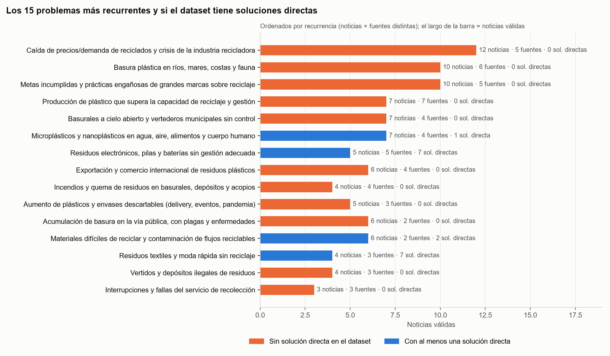

# Residuos en las noticias: informe final del pipeline

- **Eje:** residuos
- **Fecha de elaboración:** 2026-11-11
- **Base:** `residuos_clasificado_final.csv`, con 547 noticias ya clasificadas por el pipeline automático (414 marcadas como problema y 133 como solución)
- **Se relaciona con:** [[metano-residuos-problema]], que habla de los basurales a cielo abierto (ver ficha 01)

## Resumen

**El dataset sirve para encontrar problemas, pero solo después de leerlo: la mitad de lo que el clasificador marcó como «problema» no lo era.** De 414 filas, 132 describen un problema concreto, 69 son dudosas y 213 son falsos positivos (51 %). Las 132 válidas se agrupan en **36 problemas únicos**. Solo 3 tienen una solución directa en el dataset. Los otros 33 son huecos: 19 tienen soluciones parciales y 14 no tienen ninguna.

Los huecos con mejor puntaje según los criterios del jurado están en Córdoba y tratan la **cadena municipal de residuos**: basurales a cielo abierto, basura acumulada en la calle, incendios y la seguridad de quienes trabajan con la basura. Ninguno tiene una solución en el dataset. Eso no quiere decir que no tengan solución en el mundo: el dataset solo refleja lo que publicaron los medios relevados.

## Qué se hizo

| Etapa | Pregunta | Resultado |
|---|---|---|
| 1. Filtrado y agrupamiento | ¿Qué problemas aparecen de verdad en las noticias? | 132 filas válidas, agrupadas en 36 problemas únicos |
| 2. Huecos y puntuación | ¿Cuáles no tienen solución y cuáles conviene mirar? | 33 huecos puntuados y una shortlist de 5 |
| 3. Fichas | ¿Qué sabemos de cada uno? | 15 fichas que se leen solas |

Cada fila se leyó a mano y se marcó como VÁLIDA solo si describe una situación concreta que perjudica a alguien. Todas las afirmaciones citan el número de `fila` del CSV. Lo que no dice el texto está marcado como *inferido*.

## Los 15 problemas con mayor puntaje

Total ponderado de 1 a 5, con los pesos del jurado: impacto 25 %, innovación 20 %, factibilidad 20 %, escalabilidad 15 % y ecosistema 10 %. El pitch no se puntúa.

| N.º | Problema | Estado | Solidez | Total |
|---|---|---|---|---|
| 01 | [Basurales a cielo abierto](final-pipeline-residuos/resultados/fichas/01-basurales-a-cielo-abierto.md) | SIN SOLUCIÓN | ALTA | 3,72 |
| 02 | [Envases de agroquímicos](final-pipeline-residuos/resultados/fichas/02-envases-de-agroquimicos.md) | PARCIAL | BAJA | 3,72 |
| 03 | [Basura acumulada en la calle](final-pipeline-residuos/resultados/fichas/03-basura-acumulada-en-la-calle.md) | SIN SOLUCIÓN | MEDIA | 3,67 |
| 04 | [Seguridad de trabajadores de residuos](final-pipeline-residuos/resultados/fichas/04-seguridad-de-trabajadores-de-residuos.md) | SIN SOLUCIÓN | MEDIA | 3,67 |
| 05 | [Incendios en basurales y acopios](final-pipeline-residuos/resultados/fichas/05-incendios-en-basurales-y-acopios.md) | SIN SOLUCIÓN | MEDIA | 3,61 |
| 06 | [Recuperadores urbanos](final-pipeline-residuos/resultados/fichas/06-recuperadores-urbanos.md) | SIN SOLUCIÓN | BAJA | 3,39 |
| 07 | [Residuos patogénicos](final-pipeline-residuos/resultados/fichas/07-residuos-patogenicos.md) | PARCIAL | MEDIA | 3,28 |
| 08 | [Metas de reciclaje de las marcas](final-pipeline-residuos/resultados/fichas/08-metas-de-reciclaje-de-las-marcas.md) | PARCIAL | ALTA | 3,17 |
| 09 | [Cortes del servicio de recolección](final-pipeline-residuos/resultados/fichas/09-cortes-del-servicio-de-recoleccion.md) | SIN SOLUCIÓN | MEDIA | 3,17 |
| 10 | [Plástico en ríos y mares](final-pipeline-residuos/resultados/fichas/10-plastico-en-rios-y-mares.md) | SIN SOLUCIÓN | ALTA | 3,11 |
| 11 | [Trazabilidad de residuos](final-pipeline-residuos/resultados/fichas/11-trazabilidad-de-residuos.md) | PARCIAL | BAJA | 3,11 |
| 12 | [Crisis del mercado de reciclados](final-pipeline-residuos/resultados/fichas/12-crisis-del-mercado-de-reciclados.md) | PARCIAL | ALTA | 3,06 |
| 13 | [Microplásticos](final-pipeline-residuos/resultados/fichas/13-microplasticos.md) | PARCIAL | ALTA | 3,00 |
| 14 | [Vertidos ilegales](final-pipeline-residuos/resultados/fichas/14-vertidos-ilegales.md) | SIN SOLUCIÓN | MEDIA | 3,00 |
| 15 | [Derrames de residuos peligrosos](final-pipeline-residuos/resultados/fichas/15-derrames-de-residuos-peligrosos.md) | PARCIAL | BAJA | 3,00 |

El [índice de fichas](final-pipeline-residuos/resultados/fichas/00-indice.md) explica cómo se eligieron y lista los 18 huecos que quedaron afuera.

## Shortlist

Son los 4 huecos con mayor puntaje que se pueden abordar al menos en parte con un sistema y tienen evidencia ALTA o MEDIA, más 1 de evidencia BAJA que sí se puede abordar con un sistema:

1. **Basurales a cielo abierto** (ficha 01). Los vecinos necesitan que no se formen basurales cerca de sus casas y de su agua. Hoy aparecen sin control y se denuncian cuando ya existen (filas 30, 274).
2. **Basura acumulada en la calle** (ficha 03). Vecinos y comerciantes necesitan que la basura no quede en la calle después de los picos: Mercado Norte después del Carnaval y Güemes después de un fin de semana largo (filas 284, 306).
3. **Seguridad de trabajadores** (ficha 04). Hubo dos muertes por aplastamiento en basurales (filas 107, 309) y asaltos a recolectores en Villa Siburu (fila 209).
4. **Incendios en basurales y acopios** (ficha 05). Hay depósitos de plástico que se incendian (fila 22, Freyre) y basurales en llamas que causan choques en ruta (fila 294).
5. **Envases de agroquímicos** (ficha 02). Solo se recicla el 8 % de los envases (fila 49). La evidencia es BAJA y de 2020–2021: es el primero que hay que validar.

Los cuatro primeros comparten actores y territorio. Puede convenir verlos como un mismo frente.

## ¿Conviene automatizar la detección de huecos?

**No con estos datos.** Conviene automatizar lo mecánico y dejar la lectura en manos de personas.

- La única regla posible con las columnas del CSV dice que un problema es un hueco si ninguna solución declara atacar su categoría. Esa regla marca 194 filas como hueco, y 117 de ellas (60 %) son falsos positivos.
- La regla coincide con la lectura manual en solo 9 de los 36 problemas.
- Solo 29 de las 133 soluciones dicen qué problema atacan.
- La categoría original coincide con el problema real en el 39 % de las filas válidas.
- La mitad de los problemas (18 de 36) tiene 1 o 2 noticias. Si se saca una sola noticia, el top 10 por recurrencia cambia en 9 de 129 casos.
- La cabeza del ranking es estable: en 2000 remuestreos, mercado de reciclados, plástico en el mar y metas de las marcas quedan en el top 10 en el 95 % de los casos o más. El resto, no: basurales en el 84 %, incendios en el 44 % y seguridad de trabajadores en el 17 %.

Sí vale la pena automatizar la normalización, los conteos, la detección de duplicados y el análisis de sensibilidad.

## Límites

- El dataset refleja lo que publican los medios relevados. Las noticias de 2024–2026 vienen sobre todo de la prensa especializada en reciclaje de Estados Unidos y Europa. Por eso los temas de mercado y de marcas tienen muchas noticias y poca relación con Córdoba.
- Solo 23 de las 132 filas válidas son de Argentina, y 12 de Córdoba.
- Los puntajes son criterio del analista y se apoyan en las filas citadas, no en una medición.
- No se encontró el reporte `reporte_no_patrones.md` (GapScore), así que este análisis no se comparó con él.
- Todas las correcciones hechas entre etapas están en la hoja **Cambios** del Excel.

## Archivos

| Archivo | Qué tiene |
|---|---|
| [Índice de fichas](final-pipeline-residuos/resultados/fichas/00-indice.md) | Las 15 fichas de investigación |
| [analisis_problemas_residuos.xlsx](final-pipeline-residuos/resultados/analisis_problemas_residuos.xlsx) | Todas las tablas: filtrado fila por fila, problemas únicos, causas, actores, soluciones, huecos, puntuación, shortlist, algoritmo y cambios |
| [Reporte de la etapa 1](final-pipeline-residuos/resultados/reporte_problemas_residuos.md) | Filtrado completo, categorías, problemas únicos, top 10 y límites del dataset |
| [Gráfico: problemas vs. soluciones](final-pipeline-residuos/resultados/grafico_problemas_vs_soluciones.png) | Noticias de problemas y de soluciones por categoría |
| [Gráfico: fuentes por año](final-pipeline-residuos/resultados/grafico_fuentes_por_anio.png) | De qué medios viene cada año del dataset |
| [Pipeline](final-pipeline-residuos/pipeline/README.md) | Scripts y CSV de entrada, con el orden para volver a correrlo |

