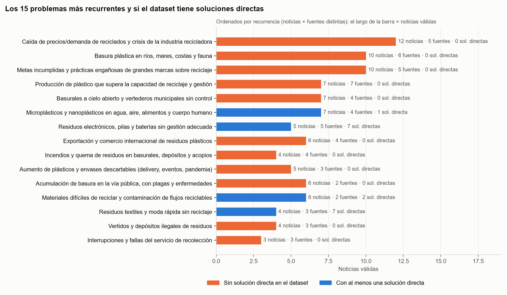
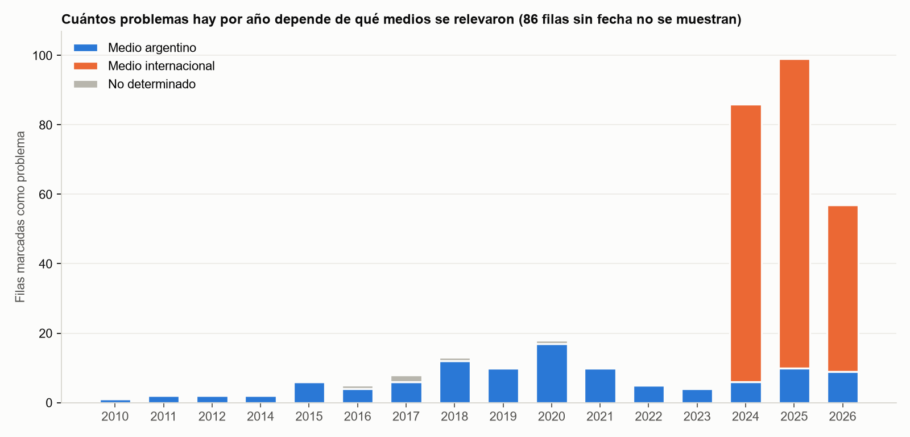

# Problemas de gestión de residuos: análisis del dataset de noticias

Hack to the Future · Córdoba Tech Week · 12 y 13/11/2026 · Track: gestión sostenible de residuos

> **Actualizado en la etapa 2:** la fila 539 pasó a DUDOSO, el desperdicio alimentario (256) se separó de orgánicos y cuatro soluciones cambiaron de directa a parcial o a ninguna. El detalle está en la hoja *Cambios* del Excel.

**Resumen.** De las 414 filas marcadas como problema, **132 son válidas**, 69 son dudosas y 213 son falsos positivos (51 %). Las válidas se agrupan en **36 problemas únicos**. Los más recurrentes son la crisis de mercado del reciclaje, la basura plástica en ecosistemas y el incumplimiento de metas de las grandes marcas. Ninguno de los tres tiene una solución directa en el dataset. Solo 23 problemas válidos están ubicados en Argentina (12 en Córdoba). Las tablas completas están en `analisis_problemas_residuos.xlsx`.

Convenciones: los números entre paréntesis o en las columnas de filas son el campo `fila` del CSV. **(inferida)** marca lo que deduje yo y el texto no dice. Los conteos de la tabla C usan solo filas VÁLIDAS.

## A. Tabla de filtrado (solo falsos positivos y dudosos)

Criterio de válido: describe una situación concreta que perjudica a personas, ecosistemas u organizaciones. Totales: VÁLIDO 132 · DUDOSO 69 · FALSO POSITIVO 213.

| fila | veredicto | motivo |
|---|---|---|
| 9 | DUDOSO | Acto político (intendente recolecta); sugiere servicio deficiente pero no lo describe |
| 10 | DUDOSO | Anuncia una investigación sobre RCD; no describe un daño concreto |
| 12 | DUDOSO | Discusión general sobre residuos industriales (neumáticos, azucareros), sin caso concreto |
| 19 | DUDOSO | Cambio legislativo para permitir incinerar; el perjuicio no se describe |
| 23 | DUDOSO | Solo título genérico ('Recolección de residuos domiciliarios'), sin descripción |
| 28 | DUDOSO | Denuncia de corrupción de dirigentes; foco judicial/político |
| 31 | DUDOSO | Fallo judicial sobre ley de incineración; evento legal más que problema |
| 48 | DUDOSO | Vertido de agua radiactiva: residuo nuclear, fuera del alcance de residuos sólidos |
| 50 | DUDOSO | Título truncado ('Ataque a camioneta de'), sin descripción |
| 70 | DUDOSO | Debate de política sobre prohibir exportaciones; no describe daño |
| 71 | DUDOSO | Título truncado, sin descripción |
| 72 | DUDOSO | Variación de precios de reciclables; no queda claro si perjudica |
| 93 | DUDOSO | Afirmación genérica sobre la población humana, sin situación concreta |
| 96 | DUDOSO | Sin descripción; 'causa indignación' no permite saber el problema |
| 104 | DUDOSO | Una madre vive de la basura; el texto lo plantea como 'desperdicio', el problema real es ambiguo |
| 111 | DUDOSO | Crítica a la lentitud de prohibiciones de plástico; foco en política |
| 118 | DUDOSO | Anécdota de influencer; problema de separación solo insinuado |
| 123 | DUDOSO | Solo título ('Residuos antibióticos'), sin descripción |
| 133 | DUDOSO | Nueva regulación para incineradoras; no describe un daño |
| 139 | DUDOSO | Investigación periodística sobre alianza gobierno-industria; perjuicio no explícito |
| 143 | DUDOSO | Temor sectorial a cambios regulatorios; perjuicio hipotético |
| 155 | DUDOSO | Reclamo sectorial sin descripción del problema |
| 162 | DUDOSO | Reformas legales en CDMX; el problema (moda rápida) no se describe |
| 190 | DUDOSO | Documento de propuestas; las barreras no se describen |
| 201 | DUDOSO | Solo título ('avanza a un ritmo insuficiente'), sin descripción |
| 206 | DUDOSO | Reclamo sectorial de normas armonizadas; perjuicio no explícito |
| 208 | DUDOSO | Cambio regulatorio del USDA; la saturación es una consecuencia posible ('puede'), no observada |
| 229 | DUDOSO | Noticia de un proyecto (solución); menciona de paso una 'crisis de disposición' |
| 235 | DUDOSO | Habla de multas aplicadas; el arrojo de basura se infiere |
| 237 | DUDOSO | Guía de descarte de inyectables; el riesgo se infiere |
| 239 | DUDOSO | Prohibición normativa; el problema de fondo no se describe |
| 247 | DUDOSO | Título truncado sobre normativa, sin descripción |
| 251 | DUDOSO | Reclamo de revisión normativa; el problema se insinúa |
| 254 | DUDOSO | Municipios envían residuos a incineradora; no se dice que haya daño |
| 263 | DUDOSO | Armonización de criterios técnicos; perjuicio no explícito |
| 268 | DUDOSO | Lista genérica de quejas vecinales (basura entre otras) |
| 271 | DUDOSO | Describe una medida de castigo; arrojo de basura inferido |
| 280 | DUDOSO | Nota divulgativa sobre compostaje casero |
| 301 | DUDOSO | Campaña educativa; el daño al alcantarillado se menciona como motivo |
| 308 | DUDOSO | Afirmación genérica de que reciclar puede contaminar, sin caso |
| 320 | DUDOSO | Foco en el apartamiento de un juez; la contaminación del Riachuelo es contexto |
| 324 | DUDOSO | Queja de una celebridad, sin datos |
| 346 | DUDOSO | Votación parlamentaria; el riesgo de greenwashing es hipotético |
| 365 | DUDOSO | Efecto de una ley sobre ventas de un producto; perjuicio comercial discutible |
| 367 | DUDOSO | Descripción confusa sobre datos incompletos |
| 368 | DUDOSO | Título truncado, sin descripción |
| 370 | DUDOSO | Lobby empresarial contra una prohibición |
| 378 | DUDOSO | Anuncio de obra; afecta a recolectores informales pero no se describe cómo |
| 381 | DUDOSO | Alegaciones a un borrador de decreto; conflicto regulatorio |
| 391 | DUDOSO | Solo título ('Desafíos del reciclaje de plásticos europeo') |
| 394 | DUDOSO | Dato de potencial (83% reciclable); el déficit actual se infiere |
| 398 | DUDOSO | Título truncado ('Ralentización del Recicl') |
| 404 | DUDOSO | Necesidad genérica de materiales de calidad |
| 415 | DUDOSO | Reclamo de criterios armonizados; perjuicio no explícito |
| 426 | DUDOSO | Título truncado, sin descripción |
| 430 | DUDOSO | Acuerdo regulatorio sobre pellets; la contaminación se infiere |
| 436 | DUDOSO | Título truncado, sin descripción |
| 447 | DUDOSO | Turistas limpian un sitio; el arrojo de basura se infiere |
| 457 | DUDOSO | Modelo de ley; la descripción critica lo que no menciona |
| 459 | DUDOSO | Descripción truncada (vestuario teatral) |
| 463 | DUDOSO | Sedimentos tras incendio forestal: no son residuos |
| 464 | DUDOSO | Enfoque jurídico (derechos humanos) de la contaminación plástica |
| 474 | DUDOSO | Persona en situación de calle atrapada en camión compactador; accidente puntual |
| 477 | DUDOSO | Proyecto de mejora (solución) sobre aerogeneradores |
| 484 | DUDOSO | Propone un sistema de monitoreo; el problema se menciona de paso |
| 525 | DUDOSO | Reclamo de ONG por más control; el daño no se describe |
| 535 | DUDOSO | Hecho histórico (1957) sin situación actual |
| 538 | DUDOSO | Aplazamiento regulatorio; perjuicio no explícito |
| 539 | DUDOSO | [Etapa 2] Perjuicio proyectado («podría»), no observado; mismo criterio que la fila 208 |
| 2 | FALSO POSITIVO | Nota de consejos para reutilizar objetos |
| 4 | FALSO POSITIVO | Disputa política por fondos |
| 6 | FALSO POSITIVO | Describe una solución (planta piloto de pilas) |
| 7 | FALSO POSITIVO | Anuncio de normativa de bolsas en supermercados |
| 13 | FALSO POSITIVO | Ley de agricultura urbana; no es de residuos |
| 14 | FALSO POSITIVO | Tema previsional (jubilados); no es de residuos |
| 17 | FALSO POSITIVO | Hecho policial (bebé en la basura) |
| 20 | FALSO POSITIVO | Opinión de un gerente de la industria plástica |
| 24 | FALSO POSITIVO | Describe una solución (modelo circular de PepsiCo) |
| 26 | FALSO POSITIVO | Anécdota comercial (bolsas con leyenda vergonzosa) |
| 29 | FALSO POSITIVO | Evento (Día Mundial sin Bolsas) |
| 33 | FALSO POSITIVO | Curiosidad (moda de sacar la basura disfrazado) |
| 34 | FALSO POSITIVO | Proyecto de ley (política) |
| 46 | FALSO POSITIVO | Accidente infantil puntual |
| 47 | FALSO POSITIVO | Describe una solución (tubo reciclable) |
| 55 | FALSO POSITIVO | Anécdota (ahorros tirados en un pañal) |
| 56 | FALSO POSITIVO | Describe una acción (reciclado de documentos) |
| 60 | FALSO POSITIVO | Salud cerebral; 'residuos' en sentido biológico |
| 61 | FALSO POSITIVO | Describe una solución (CCU recupera envases) |
| 62 | FALSO POSITIVO | Curiosidad (dinero en basural) |
| 63 | FALSO POSITIVO | Nota sobre acumular objetos en casa |
| 64 | FALSO POSITIVO | Describe una solución (programa de reutilización CABA) |
| 66 | FALSO POSITIVO | Dato positivo del reciclaje inclusivo |
| 67 | FALSO POSITIVO | Describe una solución (programa de Nueva York) |
| 68 | FALSO POSITIVO | Investigación de una solución (hormigón) |
| 73 | FALSO POSITIVO | Evento (reunión sectorial) |
| 75 | FALSO POSITIVO | Llamado institucional a usar IA |
| 76 | FALSO POSITIVO | Evento (visita de prensa) |
| 77 | FALSO POSITIVO | Medidas de política de la UE |
| 79 | FALSO POSITIVO | Evento (reto estudiantil) |
| 85 | FALSO POSITIVO | Negociación internacional (tratado de plásticos) |
| 90 | FALSO POSITIVO | Describe una solución (zapatillas con borra de café) |
| 106 | FALSO POSITIVO | Reporte de precios sin perjuicio |
| 108 | FALSO POSITIVO | Describe una solución (drones) |
| 109 | FALSO POSITIVO | Describe una solución (vaporizar plásticos) |
| 113 | FALSO POSITIVO | Describe una solución (plástico biodegradable) |
| 115 | FALSO POSITIVO | Evento (premios) |
| 116 | FALSO POSITIVO | Convocatoria a startups |
| 119 | FALSO POSITIVO | Describe una solución (Amazon elimina plásticos) |
| 122 | FALSO POSITIVO | Dato positivo (menor uso de plástico) |
| 124 | FALSO POSITIVO | Describe una solución (trazabilidad en Córdoba) |
| 125 | FALSO POSITIVO | Declaración del sector plástico |
| 128 | FALSO POSITIVO | Dato positivo (sube reciclaje PET) |
| 129 | FALSO POSITIVO | Describe una solución (planta PureCycle) |
| 132 | FALSO POSITIVO | El propio texto dice que no presenta problemas |
| 135 | FALSO POSITIVO | Anuncio de ayudas |
| 137 | FALSO POSITIVO | El propio texto dice que no aborda problemas |
| 138 | FALSO POSITIVO | Describe una solución (plataforma de compostaje) |
| 140 | FALSO POSITIVO | Describe una solución (máquina de papel) |
| 142 | FALSO POSITIVO | Anuncio de fondos públicos |
| 144 | FALSO POSITIVO | Consejo doméstico (limpieza de cocina) |
| 147 | FALSO POSITIVO | Nota informativa sobre la mosca doméstica |
| 149 | FALSO POSITIVO | Describe una solución (Waitrose) |
| 150 | FALSO POSITIVO | El texto dice que no afecta la gestión |
| 151 | FALSO POSITIVO | Describe una solución (robot de playas) |
| 156 | FALSO POSITIVO | Evento (asamblea sectorial) |
| 157 | FALSO POSITIVO | Accidente con un animal |
| 161 | FALSO POSITIVO | Evento (conferencia) |
| 164 | FALSO POSITIVO | Evento (competencia de la NASA) |
| 167 | FALSO POSITIVO | Describe una solución (botellas reutilizables en Lisboa) |
| 168 | FALSO POSITIVO | Encuesta sectorial |
| 172 | FALSO POSITIVO | Reclamo en negociación del tratado |
| 174 | FALSO POSITIVO | Consulta pública sobre sistema de depósito |
| 175 | FALSO POSITIVO | Describe una solución (financiamiento a FCC) |
| 177 | FALSO POSITIVO | Describe una solución (Codimat) |
| 180 | FALSO POSITIVO | Dato positivo (crece la recogida selectiva) |
| 183 | FALSO POSITIVO | Evento (conferencia RECOUP) |
| 186 | FALSO POSITIVO | Dato positivo (crece reciclaje de medicamentos) |
| 187 | FALSO POSITIVO | Describe una solución (puntos de reciclaje) |
| 189 | FALSO POSITIVO | Negociación del tratado (renuncia de un presidente de mesa) |
| 191 | FALSO POSITIVO | Hecho policial (restos humanos) |
| 192 | FALSO POSITIVO | Describe una herramienta lanzada |
| 200 | FALSO POSITIVO | Hecho policial (asesinato en basural) |
| 203 | FALSO POSITIVO | Nombramiento institucional |
| 204 | FALSO POSITIVO | Describe una solución (kit de préstamo) |
| 211 | FALSO POSITIVO | Residuos de pesticidas en alimentos: otro sentido de 'residuo' |
| 213 | FALSO POSITIVO | Describe una solución (filtro de nanoplásticos) |
| 216 | FALSO POSITIVO | Guía técnica de una empresa |
| 221 | FALSO POSITIVO | Describe una solución (planta piloto) |
| 222 | FALSO POSITIVO | Dato positivo (bajan residuos) |
| 223 | FALSO POSITIVO | Consejo de reutilización doméstica |
| 227 | FALSO POSITIVO | Consejo de reutilización doméstica |
| 231 | FALSO POSITIVO | Describe una solución (máquina de una estudiante) |
| 232 | FALSO POSITIVO | Consejo de reutilización doméstica |
| 233 | FALSO POSITIVO | Debate regulatorio sobre 'acero verde' |
| 234 | FALSO POSITIVO | Consejo de reutilización doméstica |
| 236 | FALSO POSITIVO | Hecho policial (hallazgo de feto) |
| 238 | FALSO POSITIVO | Describe una solución (pacto de comercio electrónico) |
| 242 | FALSO POSITIVO | Consejo doméstico |
| 243 | FALSO POSITIVO | Describe una solución (platos reutilizables) |
| 260 | FALSO POSITIVO | Consejo de reutilización doméstica |
| 261 | FALSO POSITIVO | Iniciativa educativa |
| 264 | FALSO POSITIVO | Hecho policial (cráneo en contenedor) |
| 265 | FALSO POSITIVO | Anuncio de una planta (solución) |
| 269 | FALSO POSITIVO | Agua con arsénico; no es de residuos |
| 273 | FALSO POSITIVO | Describe una solución (buitres con cámaras) |
| 275 | FALSO POSITIVO | Accidente infantil puntual |
| 276 | FALSO POSITIVO | Producto con plástico reciclado |
| 277 | FALSO POSITIVO | Anécdota de un recolector |
| 278 | FALSO POSITIVO | Aviso de servicios por feriado |
| 279 | FALSO POSITIVO | Salud cerebral; 'basura' en sentido biológico |
| 282 | FALSO POSITIVO | Ley aprobada (solución regulatoria) |
| 287 | FALSO POSITIVO | Describe una solución (emprendedor) |
| 288 | FALSO POSITIVO | Describe una solución (compostaje en Vicente López) |
| 290 | FALSO POSITIVO | Coronavirus en superficies; no es de residuos |
| 291 | FALSO POSITIVO | Obra artística con tapitas |
| 293 | FALSO POSITIVO | Hecho policial (cuerpo calcinado) |
| 296 | FALSO POSITIVO | Animales abandonados |
| 297 | FALSO POSITIVO | Hecho policial |
| 299 | FALSO POSITIVO | Formato de conciertos en pandemia |
| 300 | FALSO POSITIVO | Búsqueda de una persona desaparecida |
| 303 | FALSO POSITIVO | Describe una solución (tienda sin residuos) |
| 304 | FALSO POSITIVO | Prohibición aprobada (solución regulatoria) |
| 305 | FALSO POSITIVO | Investigación sobre radiación con serpientes |
| 307 | FALSO POSITIVO | Evento (cumbre de economía circular) |
| 310 | FALSO POSITIVO | Describe una solución (máquina recolectora en un río) |
| 311 | FALSO POSITIVO | Aviso de servicio por feriado |
| 312 | FALSO POSITIVO | Describe una solución (reciclaje de ropa en Chile) |
| 313 | FALSO POSITIVO | Anécdota (valija abandonada) |
| 314 | FALSO POSITIVO | Describe una solución (planta de carbonización) |
| 315 | FALSO POSITIVO | Nota sobre desigualdad social |
| 316 | FALSO POSITIVO | Propuestas de campaña electoral |
| 318 | FALSO POSITIVO | Describe una solución (yerba mate en baterías) |
| 319 | FALSO POSITIVO | Curiosidad de redes sociales |
| 321 | FALSO POSITIVO | Declaración de una ministra |
| 326 | FALSO POSITIVO | Negociación (derecho a reparar) |
| 331 | FALSO POSITIVO | Describe una solución (plástico marino en infraestructura) |
| 334 | FALSO POSITIVO | Contenido de celebridad |
| 338 | FALSO POSITIVO | Describe una solución (reciclaje de vidrio) |
| 339 | FALSO POSITIVO | Describe un plan (Zero Waste DC) |
| 345 | FALSO POSITIVO | Reporte de precios |
| 348 | FALSO POSITIVO | Reglamento aprobado |
| 351 | FALSO POSITIVO | Dato positivo (sube reciclaje de envases) |
| 353 | FALSO POSITIVO | Dato positivo (programa efectivo) |
| 354 | FALSO POSITIVO | Fenómeno en el cielo (basura espacial no confirmada) |
| 355 | FALSO POSITIVO | Reclamo sectorial de reconocimiento |
| 360 | FALSO POSITIVO | Describe una solución (mejora de planta WM) |
| 361 | FALSO POSITIVO | Describe una solución (reciclaje móvil) |
| 362 | FALSO POSITIVO | Inauguración de planta |
| 363 | FALSO POSITIVO | Dato positivo (71% de reutilización) |
| 364 | FALSO POSITIVO | Interés comercial en resinas recicladas |
| 374 | FALSO POSITIVO | Describe una solución (gusanos que degradan microplásticos) |
| 384 | FALSO POSITIVO | Premio a un artista |
| 385 | FALSO POSITIVO | Nota sobre economía colaborativa |
| 389 | FALSO POSITIVO | Consejo doméstico (freidora de aire) |
| 390 | FALSO POSITIVO | Concurso de la NASA |
| 393 | FALSO POSITIVO | Autorización administrativa |
| 396 | FALSO POSITIVO | Nota histórica (contenedor azul) |
| 397 | FALSO POSITIVO | Negociación internacional (INC-5) |
| 401 | FALSO POSITIVO | Describe mejoras en una planta |
| 402 | FALSO POSITIVO | Campaña de una asociación |
| 403 | FALSO POSITIVO | Convenio empresarial |
| 405 | FALSO POSITIVO | Describe una solución (innovación universitaria) |
| 406 | FALSO POSITIVO | Acuerdo institucional |
| 407 | FALSO POSITIVO | Describe una solución (recogida neumática) |
| 408 | FALSO POSITIVO | Prohibición aprobada |
| 409 | FALSO POSITIVO | Financiamiento a proyectos |
| 411 | FALSO POSITIVO | Evento (conferencia en Manila) |
| 416 | FALSO POSITIVO | Capacitación sectorial |
| 417 | FALSO POSITIVO | Describe una solución (centro de 3R Technology) |
| 419 | FALSO POSITIVO | Crítica al propio artículo, no un problema |
| 422 | FALSO POSITIVO | Describe una solución (app de Salvador) |
| 424 | FALSO POSITIVO | Describe una solución (recolección de baterías) |
| 425 | FALSO POSITIVO | Avance industrial (PP grado alimentario) |
| 427 | FALSO POSITIVO | Describe una solución (agua desde residuos orgánicos) |
| 429 | FALSO POSITIVO | Ley aprobada |
| 433 | FALSO POSITIVO | Evento sectorial |
| 434 | FALSO POSITIVO | Recomendaciones sectoriales |
| 437 | FALSO POSITIVO | Ley aprobada |
| 439 | FALSO POSITIVO | Campaña de una marca |
| 441 | FALSO POSITIVO | Oferta de servicios de una empresa |
| 445 | FALSO POSITIVO | Dato positivo (menos botellas en playas) |
| 446 | FALSO POSITIVO | Dato positivo (reciclaje de plásticos agrícolas) |
| 449 | FALSO POSITIVO | Dato positivo (menos bolsas en playas) |
| 452 | FALSO POSITIVO | Dato de gestión de una empresa |
| 453 | FALSO POSITIVO | Describe una solución (Brighton recicla plásticos) |
| 455 | FALSO POSITIVO | Evento (Día Mundial sin Bolsas) |
| 456 | FALSO POSITIVO | Empresas adoptan medidas |
| 461 | FALSO POSITIVO | Acuerdo institucional |
| 462 | FALSO POSITIVO | Objetivo de política (Euskadi) |
| 465 | FALSO POSITIVO | Describe una solución (piloto en Saltillo) |
| 471 | FALSO POSITIVO | Mejora de servicio (Madrid) |
| 473 | FALSO POSITIVO | Campaña de reparación |
| 476 | FALSO POSITIVO | Iniciativa estudiantil |
| 479 | FALSO POSITIVO | Describe una solución (restauración de suelos) |
| 482 | FALSO POSITIVO | Título truncado sin contenido |
| 485 | FALSO POSITIVO | Dato positivo (Rumanía 94%) |
| 486 | FALSO POSITIVO | Describe una solución (reciclaje textil) |
| 489 | FALSO POSITIVO | Estado de calles; no es de residuos |
| 490 | FALSO POSITIVO | Operativo de limpieza |
| 492 | FALSO POSITIVO | Dato positivo (sube recogida de orgánicos) |
| 495 | FALSO POSITIVO | Consejo doméstico |
| 497 | FALSO POSITIVO | Anécdota de objetos de una celebridad |
| 500 | FALSO POSITIVO | Adhesión institucional (CEAMSE al Pacto Global) |
| 501 | FALSO POSITIVO | Plan de mejora (Aragón) |
| 504 | FALSO POSITIVO | Tecnología de hidrógeno; no es de residuos |
| 505 | FALSO POSITIVO | Inversión en recogida (solución) |
| 507 | FALSO POSITIVO | Análisis técnico regulatorio |
| 508 | FALSO POSITIVO | Libro sobre islas |
| 509 | FALSO POSITIVO | Dato positivo (encuesta de reciclaje) |
| 510 | FALSO POSITIVO | Convenio (solución) |
| 511 | FALSO POSITIVO | Iniciativa de reciclaje textil |
| 512 | FALSO POSITIVO | Consejo de reutilización doméstica |
| 517 | FALSO POSITIVO | Hecho policial (feto en contenedor) |
| 518 | FALSO POSITIVO | Describe una solución (valorización en Canarias) |
| 520 | FALSO POSITIVO | Anuncio de ayudas |
| 521 | FALSO POSITIVO | Propuesta normativa sobre fechas de vencimiento |
| 526 | FALSO POSITIVO | Proyecto de ley |
| 528 | FALSO POSITIVO | Explica normas y sanciones |
| 531 | FALSO POSITIVO | Espectáculos; no es de residuos |
| 532 | FALSO POSITIVO | Pilotos de reciclaje (solución) |
| 536 | FALSO POSITIVO | Describe una solución (recolección de botellas) |
| 543 | FALSO POSITIVO | Documento de propuestas |

## B. Categorías normalizadas

Las variantes cortadas o mal escritas se unieron a su forma completa. RAEE y RCD quedan dentro de GESTION_DEFICIENTE_RESIDUOS_ESPECIALES. OTRO y las filas sin categoría se repartieron entre las categorías existentes según su problema de fondo, y no surgió ninguna categoría nueva con 3 casos o más. Atención: solo el 39 % de los válidos tiene una categoría original que coincide con su problema de fondo (ver F).

| categoria_final | variantes_unidas | n_total | n_validos | n_dudosos | n_falsos_positivos | recibidas_de_OTRO_o_vacio |
|---|---|---|---|---|---|---|
| CONTAMINACION_ECOSISTEMICA_Y_PLASTICOS | CON / CONT / CONTAM / CONTAMIN / CONTAMINACION / CONTAMINACION_EC / CONTAMINACION_ECOSIST / CONTAMINACION_ECOSISTEM / CONTAMINACION_ECOSISTEMICA_Y_PL / CONTAMINACION_ECOSISTEMICA_Y_PLASTIC / CONTAMINACION_ECOSISTEMICA_Y_PLASTICOS / OTRO_PROBLEMA_RESIDUOS | 104 | 46 | 13 | 45 | 11 |
| OTRO_PROBLEMA_RESIDUOS | OTRO_PROBLEMA_RESIDUOS | 87 | 6 | 3 | 78 | 0 |
| GESTION_DEFICIENTE_RESIDUOS_ESPECIALES | ELECTRONICOS_BATERIAS_RAEE / GESTION DEFICIENTE RESIDUOS ESPECIALES / GESTION DEFICIENTE RESIDUOS ESPECIALES RAEE / GESTION DEFICIENTE RESIDUOS ESPECIALES RCD / GESTION_DEFICIENTE_RESIDUOS_ESPEC / GESTION_DEFICIENTE_RESIDUOS_ESPECIALES_RAEE / OTRO_PROBLEMA_RESIDUOS | 86 | 25 | 19 | 42 | 6 |
| CONFLICTO_TERRITORIAL_Y_LABORAL | CONFLICTO / CONFLICTO_TERRITORIAL_Y_LABORAL | 56 | 15 | 15 | 26 | 0 |
| COLAPSO_Y_SATURACION_DISPOSICION_FINAL | COLAPSO_Y_SATURACION_DISPOSICICION_FINAL / COLAPSO_Y_SATURACION_DISPOSICION / COLAPSO_Y_SATURACION_DISPOSICION_FINAL / OTRO_PROBLEMA_RESIDUOS | 40 | 26 | 9 | 5 | 6 |
| BARRERAS_DE_MERCADO_Y_ECONOMICAS | BARRERAS_DE_MERCADO_Y_ECONOMICAS / OTRO_PROBLEMA_RESIDUOS | 19 | 11 | 6 | 2 | 10 |
| SIN_CATEGORIA | — | 13 | 0 | 0 | 13 | 13 |
| DESPERDICIO_ALIMENTARIO_Y_ORGANICOS | DESPERDICIO_ALIMENTARIO_Y_ORGANICOS / DESPERICIO_ALIMENTARIO_Y_ORGANICOS / OTRO_PROBLEMA_RESIDUOS | 5 | 1 | 2 | 2 | 1 |
| ESTANCAMIENTO_SEPARACION_Y_RECICLAJE | ESTANCAMIENTO_SEPARACION_Y_RECICLAJE / OTRO_PROBLEMA_RESIDUOS | 4 | 2 | 2 | 0 | 3 |

## C. Problemas únicos, ordenados por recurrencia (noticias × fuentes distintas)

Los textos de afectados y causas están recortados. Las versiones completas, con la fila de cada uno, están en la hoja C del Excel. *Sol. directas / parciales* = filas de `es_solucion`. *Ocultas* = filas marcadas como problema que en realidad describen una solución.

| nombre | categoría | n.º noticias | n.º fuentes | recurrencia | años | ubicación (texto) | afectados | causas | soluciones existentes (filas) | filas de evidencia |
|---|---|---|---|---|---|---|---|---|---|---|
| Caída de precios/demanda de reciclados y crisis de la industria recicladora | BARRERAS_DE_MERCADO_Y_ECONOMICAS | 12 | 5 | 60 | 2024–2026 | Argentina (otras), Asia / África / Medio Oriente, Australia, EE.UU., Europa / UE | Comerciantes internacionales de papel reciclado [84]; Empresas de reciclaje de plásticos en Europa [120]; Consumidores, fabricantes y… | Declinaciones en los principales compradores en Tailandia e India [84]; Adversos mercados y demanda baja por plásticos reciclados [185];… · (inferida) Material virgen más barato; importaciones; costos energéticos; regulaciones fragmentadas (filas 420, 442, 466 lo dicen) | Directas: — · Parciales: 134, 199, 230, 337, 357, 380, 516, 534 · Ocultas: — | 84, 120, 185, 262, 329, 369, 375, 420, 442, 448, 466, 487 |
| Basura plástica en ríos, mares, costas y fauna | CONTAMINACION_ECOSISTEMICA_Y_PLASTICOS | 10 | 6 | 60 | 2018–2026 (+3 sin fecha) | América Latina (otros), Europa / UE | Costa argentina; Pobladores costeros [15]; Miles de especies de peces, moluscos y plantas marinas [35]; Cobras reales, aves y mamíferos… | Viento de la sudestada; Insuficiente conciencia ambiental y falta de campañas de divulgación [15]; Ingestión accidental de plásticos por… · (inferida) Mala gestión en tierra que termina en cursos de agua; vertederos desbordados (fila 45 lo dice) | Directas: — · Parciales: — · Ocultas: 108, 151, 310, 331, 510 | 15, 35, 44, 45, 51, 53, 178, 225, 289, 472 |
| Metas incumplidas y prácticas engañosas de grandes marcas sobre reciclaje | RESPONSABILIDAD_CORPORATIVA | 10 | 5 | 50 | 2024–2025 (+1 sin fecha) | EE.UU. | Amazon, consumidores y recicladores [78]; Consumidores de Apple; Comunidad ambiental [81]; Consumidores, inversionistas y sociedad en… | Falta de control sobre el manejo del material reciclable [78]; Ineficiencia en el sistema de reciclaje; Desinformación del consumidor [81];… · (inferida) Compromisos voluntarios sin control externo; incentivos económicos para seguir con envases descartables | Directas: — · Parciales: 131 · Ocultas: — | 78, 81, 89, 91, 100, 114, 126, 127, 158, 444 |
| Producción de plástico que supera la capacidad de reciclaje y gestión | CONTAMINACION_ECOSISTEMICA_Y_PLASTICOS | 7 | 7 | 49 | 2022–2026 | Europa / UE, Reino Unido | Comunidad global de consumidores y fabricantes [58]; Hogares británicos [344]; Medio ambiente, especies animales y vegetales [359];… | Ineficiencia en la gestión de residuos plásticos [58]; Desconocimiento de la importancia del reciclaje; Ineficiencia en la gestión de… · (inferida) La producción crece más rápido que la capacidad de reciclaje (filas 359, 533 lo dicen) | Directas: — · Parciales: 1, 27, 88, 163, 171, 224, 258, 259, 285, 342, 421, 428, 460, 498, 544 · Ocultas: 24, 109, 113, 149, 231, 360, 361, 536 | 58, 82, 344, 359, 458, 533, 537 |
| Basurales a cielo abierto y vertederos municipales sin control | COLAPSO_Y_SATURACION_DISPOSICION_FINAL | 7 | 4 | 28 | 2016–2020 (+2 sin fecha) | Argentina (otras), Buenos Aires / CABA / AMBA, Córdoba (ciudad/provincia) | Vecinos del barrio San Vicente [30]; Turistas, residentes de Bariloche, ecosistemas naturales [65]; Vecinos del barrio La Quebrada,… | Desconexión entre la imagen turística y la realidad ambiental [65]; No cumplimiento de la ley provincial 9088 [274]; Ineficiencia en la… · (inferida) Falta de infraestructura municipal de disposición; incumplimiento de normativa provincial (fila 274 lo dice); poca fiscalización | Directas: — · Parciales: — · Ocultas: 273 | 8, 30, 65, 274, 283, 298, 400 |
| Microplásticos y nanoplásticos en agua, aire, alimentos y cuerpo humano | CONTAMINACION_ECOSISTEMICA_Y_PLASTICOS | 7 | 4 | 28 | 2024–2026 (+2 sin fecha) | América Latina (otros) | Consumidores mexicanos y personas en general [245]; Comunidad general, especialmente poblaciones jóvenes [515] | Producción y desechos de plásticos [515] · (inferida) Degradación de plásticos y desgaste de neumáticos; tratamiento de aguas que no los retiene | Directas: 547 · Parciales: — · Ocultas: 213, 374 | 121, 165, 198, 214, 245, 502, 515 |
| Residuos electrónicos, pilas y baterías sin gestión adecuada | GESTION_DEFICIENTE_RESIDUOS_ESPECIALES | 5 | 5 | 25 | 2021–2026 (+1 sin fecha) | Asia / África / Medio Oriente | Comunidad de residuos electrónicos; Trabajadores del sector [42]; Población de la Franja de Gaza; Trabajadores del vertedero [59];… | La rápida obsolescencia de los dispositivos electrónicos [302]; Desconocimiento de la importancia de gestionar adecuadamente los residuos… · (inferida) Obsolescencia rápida (fila 302 lo dice); ausencia de canales de recolección diferenciada | Directas: 95, 199, 219, 330, 435, 496, 534 · Parciales: 166, 176, 218 · Ocultas: 6, 64, 282, 424 | 42, 59, 117, 302, 513 |
| Exportación y comercio internacional de residuos plásticos | COMERCIO_INTERNACIONAL_DE_RESIDUOS | 6 | 4 | 24 | 2020–2026 | Asia / África / Medio Oriente, Europa / UE, Reino Unido | Sri Lanka; Gran Bretaña [39]; Países europeos, Turquía [43]; Biffa; Instituciones ambientales [194]; Países ricos que reciben residuos… | Política china de reducción de residuos [295]; Nuevas regulaciones malayas [454]; Ineficiencia regulatoria y falta de fiscalización [514] · (inferida) Costos menores de gestión en países receptores; controles débiles | Directas: — · Parciales: 230, 498 · Ocultas: 417 | 39, 43, 194, 295, 454, 514 |
| Incendios y quema de residuos en basurales, depósitos y acopios | CONTAMINACION_ECOSISTEMICA_Y_PLASTICOS | 4 | 4 | 16 | 2018–2025 (+1 sin fecha) | Asia / África / Medio Oriente, Australia, Córdoba (ciudad/provincia) | Bomberos voluntarios y profesionales; Comunidad de Freyere [22]; Comunidades sud africanas [188]; Kangaroo Plastics Technology; Residuos… | Desconexión de suministro eléctrico; Ignición accidental [22]; Problema de depósito de residuos no cumpliendo requisitos de seguridad… · (inferida) Acopios sin medidas contra incendio (fila 451 lo dice); quema como forma de eliminación | Directas: — · Parciales: — · Ocultas: — | 22, 188, 294, 451 |
| Aumento de plásticos y envases descartables (delivery, eventos, pandemia) | CONTAMINACION_ECOSISTEMICA_Y_PLASTICOS | 5 | 3 | 15 | 2024–2026 (+2 sin fecha) | EE.UU., Europa / UE, Reino Unido | Comunidad italiana y el medio ambiente [38]; 74% de los británicos; Comerciantes y organizadores de eventos [519] | Eventos deportivos masivos; Consumo excesivo de plásticos [519] · (inferida) Modelos de consumo de un solo uso (delivery, eventos) | Directas: — · Parciales: 74, 317, 322, 327, 352 · Ocultas: 61, 119, 167, 238, 243, 303 | 38, 358, 376, 470, 519 |
| Acumulación de basura en la vía pública, con plagas y enfermedades | COLAPSO_Y_SATURACION_DISPOSICION_FINAL | 6 | 2 | 12 | 2019–2025 (+4 sin fecha) | América Latina (otros), Córdoba (ciudad/provincia) | Comerciantes, compradores y visitantes del Mercado Norte [284]; Vecinos de Güemes [306] | Sin causas en el texto · (inferida) Frecuencia de recolección insuficiente frente a picos (bares, carnaval); falta de contenedores | Directas: — · Parciales: — · Ocultas: — | 170, 212, 284, 306, 373, 542 |
| Materiales difíciles de reciclar y contaminación de flujos reciclables | BARRERAS_DE_MERCADO_Y_ECONOMICAS | 6 | 2 | 12 | 2024–2025 | EE.UU. | Industria de embalajes y reciclaje [94]; Fabricantes de embalajes plásticos flexibles; Recicladores; Consumidores [184]; Eureka Recycling… | Barreras técnicas y económicas [94]; Ineficiencias en el sistema de reciclaje; Costos elevados para el reciclaje [184]; Mayor volumen de… · (inferida) Diseño de envases con formatos/materiales sin valor de recuperación | Directas: 169, 356 · Parciales: 88, 103, 217, 250, 347, 499 · Ocultas: 47, 129, 175, 187, 532 | 94, 184, 371, 372, 480, 483 |
| Residuos textiles y moda rápida sin reciclaje | RESIDUOS_TEXTILES | 4 | 3 | 12 | 2025–2025 | Europa / UE | Medio ambiente, consumidores, industria textil [154]; Comunidad global de consumidores y productores de moda [438] | Aumento en la producción de prendas de vestir y calzado; Modelo de consumo rápido [154]; Modelo de producción masiva; Alto volumen de… · (inferida) Moda rápida y producción masiva (filas 154, 438 lo dicen); falta de recolección separada | Directas: 98, 141, 182, 202, 377, 413, 414 · Parciales: 41, 228, 257, 494 · Ocultas: 312, 486 | 145, 154, 160, 438 |
| Vertidos y depósitos ilegales de residuos | CONTAMINACION_ECOSISTEMICA_Y_PLASTICOS | 4 | 3 | 12 | 2019–2026 (+1 sin fecha) | América Latina (otros), Reino Unido | Residentes cercanos al campo [130]; Mar y ecosistemas marinos [286]; Comunidad de Kidlington, ciudadanos y empresas responsables [503] | Sin causas en el texto · (inferida) Costos de disposición legal; fiscalización insuficiente | Directas: — · Parciales: — · Ocultas: — | 130, 181, 286, 503 |
| Interrupciones y fallas del servicio de recolección | CONFLICTO_TERRITORIAL_Y_LABORAL | 3 | 3 | 9 | 2012–2015 (+1 sin fecha) | Buenos Aires / CABA / AMBA, Córdoba (ciudad/provincia) | Vecinos de la Ciudad de Buenos Aires [267]; Vecinos de la zona norte de Córdoba; Empleados de Lusa [272] | Sin causas en el texto · (inferida) Conflictos gremiales en el servicio (filas 267, 272); dependencia de un único prestador | Directas: — · Parciales: — · Ocultas: 407 | 99, 267, 272 |
| Inseguridad y muertes de trabajadores en basurales y recolección | CONFLICTO_TERRITORIAL_Y_LABORAL | 3 | 3 | 9 | sin fecha | Córdoba (ciudad/provincia) | Sergio López, recolector de residuos [107] | Sin causas en el texto · (inferida) Trabajo informal en basurales sin protección; inseguridad urbana en recorridos | Directas: — · Parciales: — · Ocultas: — | 107, 209, 309 |
| Bajas tasas de reciclaje y metas de reciclaje incumplidas (países/ciudades) | ESTANCAMIENTO_SEPARACION_Y_RECICLAJE | 4 | 2 | 8 | 2025–2026 (+1 sin fecha) | América Latina (otros), España | Comunidad española; Medio ambiente [546] | Sin causas en el texto · (inferida) Infraestructura y políticas insuficientes para alcanzar metas | Directas: — · Parciales: 173, 328 · Ocultas: 465 | 86, 146, 527, 546 |
| Residuos hospitalarios/patogénicos mal gestionados | GESTION_DEFICIENTE_RESIDUOS_ESPECIALES | 3 | 2 | 6 | 2014–2020 (+1 sin fecha) | Buenos Aires / CABA / AMBA | Comunidad sanitaria y vecinos de Palermo [5]; Hospitales italianos, pacientes y trabajadores [292] | La rápida expansión de casos de COVID-19 en Italia [292] · (inferida) Picos de generación (COVID); controles insuficientes en la cadena de tratamiento | Directas: — · Parciales: 335 · Ocultas: — | 5, 292, 350 |
| Saturación de rellenos sanitarios y disputas por la disposición final | COLAPSO_Y_SATURACION_DISPOSICION_FINAL | 2 | 2 | 4 | 2011–2024 | Argentina (otras) | Comunidad argentina; Gobierno argentino [3] | Sin causas en el texto · (inferida) Crecimiento de la generación sin cambio de modelo de gestión; disputas entre jurisdicciones (fila 387) | Directas: — · Parciales: 250, 255, 266, 524 · Ocultas: — | 3, 387 |
| Baja separación de residuos en origen (hogares) | ESTANCAMIENTO_SEPARACION_Y_RECICLAJE | 2 | 2 | 4 | 2020–2020 (+1 sin fecha) | Buenos Aires / CABA / AMBA | Comunidad de la Ciudad de Buenos Aires [101] | Sin causas en el texto · (inferida) Falta de cestos diferenciados (fila 101 lo dice); salida de recuperadores en pandemia (fila 32) | Directas: — · Parciales: 92, 210, 352, 366, 431, 467 · Ocultas: 422, 453, 505 | 32, 101 |
| Plásticos compostables/biodegradables que no se degradan en la práctica | CONTAMINACION_ECOSISTEMICA_Y_PLASTICOS | 2 | 2 | 4 | 2024–2025 | Reino Unido | Consumidores, fabricantes y recicladores [102]; Comunidad científica, agricultores y entornos naturales [195] | Descomposición incompleta de los plásticos biodegradables [195] · (inferida) Certificaciones que no reflejan condiciones reales de compostaje; etiquetado confuso (fila 102) | Directas: — · Parciales: 97, 440 · Ocultas: — | 102, 195 |
| Envases vacíos de agroquímicos descartados sin control | GESTION_DEFICIENTE_RESIDUOS_ESPECIALES | 2 | 2 | 4 | 2020–2021 | Argentina (otras), Buenos Aires / CABA / AMBA | Comunidad rural y empresas de fitosanitarios [36]; Comunidad agrícola; Medio ambiente [49] | Desconocimiento de la importancia de la gestión adecuada de estos envases [36]; Ineficiencia en la implementación de la ley; Actitudes… · (inferida) Implementación débil de la ley de envases fitosanitarios (fila 49 lo dice) | Directas: — · Parciales: 332 · Ocultas: 446 | 36, 49 |
| Basura abandonada por turistas y eventos masivos en espacios naturales | CONTAMINACION_ECOSISTEMICA_Y_PLASTICOS | 2 | 2 | 4 | 2018–2021 | Córdoba (ciudad/provincia) | Turistas y personal del balneario [16] | Actitud de los turistas y falta de educación ambiental [16] · (inferida) Falta de educación ambiental y de servicios en sitios turísticos (fila 16 lo dice) | Directas: — · Parciales: 74 · Ocultas: — | 16, 54 |
| Falta de trazabilidad y datos confiables en la gestión de residuos | GESTION_DEFICIENTE_RESIDUOS_ESPECIALES | 2 | 2 | 4 | 2025–2026 | No mencionada | Empresas envasadoras [205]; Empresas que gestionan residuos industriales [481] | Falta de tecnología y sistemas de seguimiento [481] · (inferida) Gestión manual sin sistemas de seguimiento (fila 481 lo dice) | Directas: 131, 443 · Parciales: 179, 202, 253, 343, 499 · Ocultas: 124, 192 | 205, 481 |
| Impactos ambientales del propio reciclaje (químico/avanzado) | CONTAMINACION_ECOSISTEMICA_Y_PLASTICOS | 2 | 1 | 2 | 2024–2024 | No mencionada | Animales [386] | Sin causas en el texto · (inferida) Tecnologías de alto consumo energético; fricción mecánica que libera partículas | Directas: — · Parciales: 252 · Ocultas: — | 379, 386 |
| Residuos generados por desastres y conflictos armados | COLAPSO_Y_SATURACION_DISPOSICION_FINAL | 2 | 1 | 2 | 2020–2020 (+1 sin fecha) | Asia / África / Medio Oriente, EE.UU. | Residentes de Nueva Orleans [52] | Sin causas en el texto · (inferida) Eventos extremos que superan la capacidad de recolección | Directas: — · Parciales: — · Ocultas: — | 37, 52 |
| Recuperadores urbanos (cartoneros) desplazados o en conflicto | CONFLICTO_TERRITORIAL_Y_LABORAL | 1 | 1 | 1 | 2019–2019 | No mencionada | No informado en el texto | Sin causas en el texto · (inferida) Cambios en el sistema de contenedores que afectan el acceso al material | Directas: — · Parciales: — · Ocultas: — | 25 |
| Incineración y valorización energética cuestionadas | COLAPSO_Y_SATURACION_DISPOSICION_FINAL | 1 | 1 | 1 | 2025–2025 | No mencionada | Poblaciones urbanas; Medio ambiente; Salud pública [196] | Sin causas en el texto · (inferida) Falta de alternativas de disposición; presión por generar energía | Directas: — · Parciales: — · Ocultas: — | 196 |
| Derrames y contaminación por residuos industriales peligrosos | GESTION_DEFICIENTE_RESIDUOS_ESPECIALES | 1 | 1 | 1 | 2017–2017 | Córdoba (ciudad/provincia) | Población de la zona; Agua del Canal Los Molinos [11] | Sin causas en el texto · (inferida) Fallas de control en plantas de tratamiento de residuos peligrosos | Directas: — · Parciales: 110, 215, 468, 475 · Ocultas: 479 | 11 |
| Residuos orgánicos sin tratamiento adecuado (compostaje e infraestructura) | DESPERDICIO_ALIMENTARIO_Y_ORGANICOS | 1 | 1 | 1 | 2024–2024 | España | Comunidad catalana; Empresas de servicios públicos [80] | Falta de infraestructura para reciclaje y compostaje; Ineficiencia en la implementación de políticas ambientales [80] · (inferida) Falta de infraestructura y de políticas de compostaje (fila 80 lo dice) | Directas: 83, 207, 246, 336, 383, 412, 491, 523, 541 · Parciales: 248, 395, 540 · Ocultas: 67, 138, 288, 314 | 80 |
| Desperdicio de alimentos en hogares y empresas | DESPERDICIO_ALIMENTARIO_Y_ORGANICOS | 1 | 1 | 1 | 2026–2026 | Europa / UE | Hogares, empresas y organizaciones [256] | Falta de conciencia y falta de infraestructura [256] · (inferida) Falta de conciencia y de infraestructura (fila 256 lo dice) | Directas: — · Parciales: 246, 541 · Ocultas: — | 256 |
| Residuos arrojados al inodoro que colapsan cloacas y depuradoras | COLAPSO_Y_SATURACION_DISPOSICION_FINAL | 1 | 1 | 1 | 2015–2015 | No mencionada | No informado en el texto | Sin causas en el texto · (inferida) Hábitos de descarte en el hogar | Directas: — · Parciales: — · Ocultas: — | 270 |
| Residuos de productos de higiene femenina no reciclables | OTRO_PROBLEMA_RESIDUOS | 1 | 1 | 1 | 2018–2018 | No mencionada | Mujeres; Medio Ambiente [18] | Aumento de la demanda de productos de higiene femenino; Contenido plástico de los productos [18] | Directas: — · Parciales: — · Ocultas: — | 18 |
| Costos ambientales de la cadena de reciclaje de aluminio y acero | BARRERAS_DE_MERCADO_Y_ECONOMICAS | 1 | 1 | 1 | 2024–2024 | No mencionada | Medio Ambiente, Sociedad y Salud [112] | Problemas en la cadena de suministro desde la extracción de minerales hasta los productos finales [112] | Directas: 341 · Parciales: 226, 478, 516 · Ocultas: — | 112 |
| Alta generación de residuos por habitante | OTRO_PROBLEMA_RESIDUOS | 1 | 1 | 1 | 2018–2018 | Buenos Aires / CABA / AMBA | Cada habitante de la Ciudad Autónoma de Buenos Aires [281] | Desconocimiento de la importancia del reciclaje; Costos asociados a la separación de residuos [281] | Directas: — · Parciales: — · Ocultas: — | 281 |
| Basura espacial que cae en ecosistemas | CONTAMINACION_ECOSISTEMICA_Y_PLASTICOS | 1 | 1 | 1 | sin fecha | América Latina (otros) | No informado en el texto | Sin causas en el texto | Directas: — · Parciales: — · Ocultas: — | 530 |

Problemas con evidencia solo dudosa (0 válidas): RCD, residuos de construcción (10, 394; con solución directa en 506), y NEUMAT, neumáticos fuera de uso (12, 155).

## D. Top 10 de problemas recurrentes con pocas o ninguna solución

Criterio: los de mayor recurrencia que tienen como máximo 1 solución directa. Quedan afuera RAEE (7 directas), TEXTIL (7), ORGAN (9) y DIFICIL (2): son los temas donde el dataset concentra soluciones.

**1. Caída de precios/demanda de reciclados y crisis de la industria recicladora** (12 noticias, 5 fuentes, recurrencia 60). 12 noticias de 5 fuentes, todas 2024–2026: caen precios y demanda de plástico y papel reciclado (448, 375, 84), cierran plantas (185) y la industria europea habla de crisis por material virgen barato, importaciones y costos de energía (420, 442, 466). Ninguna solución lo ataca de frente: las 8 parciales (134, 357, 380, 516…) son marcas que usan contenido reciclado, lo que crea algo de demanda pero no estabiliza precios. Todas las fuentes son prensa técnica europea o de EE. UU.; Argentina aparece solo en 375 (exportación de papel).

**2. Basura plástica en ríos, mares, costas y fauna** (10 noticias, 6 fuentes, recurrencia 60). 10 noticias de 6 fuentes, entre 2018 y 2026: plástico en fauna (44, 51, 53), costas (15, 178, 225), ríos (45) y la Amazonía (472). Es el problema más sostenido en el tiempo dentro del dataset. No hay soluciones marcadas como tales que lo ataquen; las únicas aparecen escondidas en filas mal etiquetadas como problema (robot de playas 151, máquina en río 310, convenio Coca-Cola 510), todas de limpieza al final del ciclo. 44 y 289 son la misma noticia (cobras) publicada dos veces.

**3. Metas incumplidas y prácticas engañosas de grandes marcas sobre reciclaje** (10 noticias, 5 fuentes, recurrencia 50). 10 noticias de 5 fuentes (2024–2025): Coca-Cola y PepsiCo bajan o incumplen metas (100, 126, 127, 158, 444), Exxon es demandada por engaño sobre el reciclaje (114), y los programas de Amazon y Apple se cuestionan (78, 81). Las soluciones del dataset no apuntan a esto: solo hay un pasaporte digital de plásticos (131, parcial) y anuncios de metas de Danone (340), que son del mismo tipo de compromiso voluntario que el problema critica. 158 y 444 son la misma noticia.

**4. Producción de plástico que supera la capacidad de reciclaje y gestión** (7 noticias, 7 fuentes, recurrencia 49). 7 noticias de 7 fuentes distintas (la mayor diversidad del dataset): la producción de plástico crece más rápido que la capacidad de reciclaje (58, 359, 533, 537). Tiene 15 soluciones parciales, pero casi todas son productos hechos con plástico reciclado (bancos 285, casa de botellas 258, morteros 544) o bioplásticos (342, 224, 428): reciclan una parte o sustituyen material, ninguna reduce la producción. Esa es la brecha.

**5. Basurales a cielo abierto y vertederos municipales sin control** (7 noticias, 4 fuentes, recurrencia 28). 7 noticias (2016–2020 y 2 sin fecha), 5 con ubicación en Argentina: San Vicente (30), Huerta Grande a 150 m de la cisterna del pueblo (274), Tancacha (400), Luján (298), Bariloche (65). Es el problema local más repetido. No hay ninguna solución en el dataset; solo el cierre de Tancacha, que se cuenta en la misma noticia (400). Que no haya noticias después de 2020 puede ser un efecto de los medios relevados, no una mejora (ver F).

**6. Microplásticos y nanoplásticos en agua, aire, alimentos y cuerpo humano** (7 noticias, 4 fuentes, recurrencia 28). 7 noticias de 4 fuentes (2024–2026): microplásticos en el cuerpo humano (515), alimentos (165, 245), aire por desgaste de neumáticos (502) y océanos (198). Una sola solución directa (547, filtración en aguas residuales) y dos escondidas en filas de problema (213, 374). Ninguna toca las fuentes de emisión (neumáticos, degradación de envases).

**7. Exportación y comercio internacional de residuos plásticos** (6 noticias, 4 fuentes, recurrencia 24). 6 noticias de 4 fuentes (2020–2026): residuos devueltos o acumulados en otros países (39, 43), el cierre de China a las importaciones (295), nuevas restricciones de Malasia (454) y una exportación ilegal de plástico contaminado (514). Solo hay soluciones parciales: plantas en Nigeria (498) e inversión en India (230), que aumentan la capacidad local sin abordar el comercio.

**8. Incendios y quema de residuos en basurales, depósitos y acopios** (4 noticias, 4 fuentes, recurrencia 16). 4 noticias de 4 fuentes distintas: un depósito de plásticos quemado en Freyre, Córdoba (22); un incendio en un basural a cielo abierto que provocó un choque de seis camiones en la ruta 9 (294); quema de residuos en Sudáfrica (188); y un reciclador sancionado por un acopio con riesgo de incendio (451). Ninguna solución en el dataset. Se relaciona con BASURAL (los basurales se queman) y con el aumento de acopios (inferido).

**9. Aumento de plásticos y envases descartables (delivery, eventos, pandemia)** (5 noticias, 3 fuentes, recurrencia 15). 5 noticias de 3 fuentes (2024–2026): delivery (358), eventos deportivos (519), mascarillas de la pandemia (470) y un récord de desechos plásticos en California pese a la prohibición de bolsas (376). Hay 5 soluciones parciales (préstamo de objetos 327, devolución de envases 352, Cosquín Rock 74) y varias escondidas en filas de problema (167, 243, 303). Es de los problemas con más soluciones parciales, pero ninguna es para delivery.

**10. Acumulación de basura en la vía pública, con plagas y enfermedades** (6 noticias, 2 fuentes, recurrencia 12). 6 noticias (2 fuentes), 3 en Córdoba: barrios (170), Güemes después de un fin de semana largo (306), Mercado Norte después del Carnaval (284); más Bogotá (212, 373) y Cuba (542), con ratas y enfermedades. Ninguna solución en el dataset. Varias noticias no tienen descripción ni causas (170, 212), así que la causa (picos de generación frente a la frecuencia de recolección) es inferida.

Les siguen tres problemas locales con 3–4 noticias y ninguna solución en el dataset: vertidos y depósitos ilegales (VERTIDO: 130, 181, 286, 503), fallas del servicio de recolección (SERVICIO: 99, 267, 272 — CEAMSE y Lusa) e inseguridad de trabajadores en basurales y recolección (TRABSEG: 107, 209, 309 — dos muertes aplastados y asaltos en Villa Siburu).

## E. Causas compartidas

*Problemas (texto)* = el problema tiene al menos una fila válida cuya causa o descripción menciona esa causa (búsqueda por palabras clave, revisada a mano). *Problemas (inferidos)* = yo los asocio, pero el texto no lo dice.

| causa | problemas que la comparten (texto, con filas) | problemas (inferidos) | soluciones que la atacan (filas) |
|---|---|---|---|
| Sistemas de reciclaje y gestión ineficientes o sin infraestructura | Envases vacíos de agroquímicos descartados sin control [filas 49]; Basurales a cielo abierto y vertederos municipales sin control [filas 298]; Desperdicio de alimentos en hogares y empresas [filas 256]; Materiales difíciles de reciclar y contaminación de flujos reciclables [filas 480]; Metas incumplidas y prácticas engañosas de grandes marcas sobre reciclaje [filas 81]; Residuos orgánicos sin tratamiento adecuado (compostaje e infraestructura) [filas 80]; Basura plástica en ríos, mares, costas y fauna [filas 45, 225]; Producción de plástico que supera la capacidad de reciclaje y gestión [filas 58, 344, 533] | Bajas tasas de reciclaje y metas de reciclaje incumplidas (países/ciudades); Baja separación de residuos en origen (hogares); Residuos electrónicos, pilas y baterías sin gestión adecuada | 83, 246, 491, 523, 88, 171, 1, 498, 92 |
| Desconocimiento o falta de conciencia de la población | Envases vacíos de agroquímicos descartados sin control [filas 36, 49]; Basurales a cielo abierto y vertederos municipales sin control [filas 298]; Desperdicio de alimentos en hogares y empresas [filas 256]; Alta generación de residuos por habitante [filas 281]; Basura plástica en ríos, mares, costas y fauna [filas 15, 225]; Producción de plástico que supera la capacidad de reciclaje y gestión [filas 344]; Residuos electrónicos, pilas y baterías sin gestión adecuada [filas 513]; Basura abandonada por turistas y eventos masivos en espacios naturales [filas 16] | Residuos orgánicos sin tratamiento adecuado (compostaje e infraestructura); Baja separación de residuos en origen (hogares) | 541, 248, 92, 431, 366 |
| Regulación débil, fragmentada o sin fiscalización | Envases vacíos de agroquímicos descartados sin control [filas 49]; Basurales a cielo abierto y vertederos municipales sin control [filas 274]; Exportación y comercio internacional de residuos plásticos [filas 514]; Caída de precios/demanda de reciclados y crisis de la industria recicladora [filas 369, 466]; Residuos orgánicos sin tratamiento adecuado (compostaje e infraestructura) [filas 80]; Residuos electrónicos, pilas y baterías sin gestión adecuada [filas 513] | Materiales difíciles de reciclar y contaminación de flujos reciclables; Metas incumplidas y prácticas engañosas de grandes marcas sobre reciclaje; Vertidos y depósitos ilegales de residuos | 197, 506, 343, 443, 253 |
| Diseño de productos difíciles de reciclar u obsolescencia | Plásticos compostables/biodegradables que no se degradan en la práctica [filas 195]; Materiales difíciles de reciclar y contaminación de flujos reciclables [filas 372, 480, 483]; Residuos de productos de higiene femenina no reciclables [filas 18]; Residuos electrónicos, pilas y baterías sin gestión adecuada [filas 302]; Bajas tasas de reciclaje y metas de reciclaje incumplidas (países/ciudades) [filas 527] | Producción de plástico que supera la capacidad de reciclaje y gestión | 356, 169, 166, 440, 131 |
| Falta de control y trazabilidad sobre el destino del material | Envases vacíos de agroquímicos descartados sin control [filas 36]; Exportación y comercio internacional de residuos plásticos [filas 514]; Metas incumplidas y prácticas engañosas de grandes marcas sobre reciclaje [filas 78, 91]; Falta de trazabilidad y datos confiables en la gestión de residuos [filas 481] | Vertidos y depósitos ilegales de residuos; Residuos hospitalarios/patogénicos mal gestionados | 131, 443, 202, 499 |
| Producción creciente o excesiva de plástico | Materiales difíciles de reciclar y contaminación de flujos reciclables [filas 184]; Microplásticos y nanoplásticos en agua, aire, alimentos y cuerpo humano [filas 515]; Producción de plástico que supera la capacidad de reciclaje y gestión [filas 82, 359, 458, 533] | Basura plástica en ríos, mares, costas y fauna; Aumento de plásticos y envases descartables (delivery, eventos, pandemia); Exportación y comercio internacional de residuos plásticos | 342, 224, 428, 421, 163, 259, 327, 352, 322 |
| Condiciones de trabajo inseguras e informales | Incendios y quema de residuos en basurales, depósitos y acopios [filas 451]; Interrupciones y fallas del servicio de recolección [filas 272]; Inseguridad y muertes de trabajadores en basurales y recolección [filas 107] | Recuperadores urbanos (cartoneros) desplazados o en conflicto | Ninguna en el dataset |
| Mercados débiles: baja demanda y precios de reciclados frente al material virgen | Materiales difíciles de reciclar y contaminación de flujos reciclables [filas 94, 184]; Caída de precios/demanda de reciclados y crisis de la industria recicladora [filas 185, 369, 420, 442, 448] | Exportación y comercio internacional de residuos plásticos; Residuos textiles y moda rápida sin reciclaje | 134, 357, 380, 516, 199, 534, 337 |
| Consumo rápido y descartable (moda rápida, delivery, eventos, un solo uso) | Aumento de plásticos y envases descartables (delivery, eventos, pandemia) [filas 38, 358, 519]; Residuos textiles y moda rápida sin reciclaje [filas 154, 438] | Residuos electrónicos, pilas y baterías sin gestión adecuada; Basura abandonada por turistas y eventos masivos en espacios naturales | 327, 352, 74, 141, 414, 182, 377 |

### Actores que aparecen seguido

Menciones por búsqueda de nombres en título, descripción, afectados y causas (problemas) o en nombre, descripción y quién impulsa (soluciones).

| actor | en_problemas_validos | filas_problemas_validos | en_todas_las_filas_problema | en_soluciones | filas_soluciones |
|---|---|---|---|---|---|
| PepsiCo | 4 | 89, 100, 158, 444 | 5 | 0 | — |
| Gobiernos nacionales/provinciales | 4 | 22, 112, 387, 487 | 22 | 3 | 246, 506, 516 |
| Coca-Cola | 3 | 89, 126, 127 | 4 | 0 | — |
| Municipios / intendentes | 3 | 8, 146, 196 | 12 | 0 | — |
| Asociaciones del sector reciclaje (EuRIC, FEAD, Recycling Europe, RECOUP…) | 3 | 194, 442, 451 | 12 | 1 | 443 |
| Unión Europea (Comisión/Parlamento) | 2 | 160, 256 | 12 | 1 | 197 |
| ONG / organizaciones ambientales | 2 | 114, 126 | 4 | 0 | — |
| Vecinos | 2 | 5, 32 | 5 | 0 | — |
| Exxon Mobil | 1 | 114 | 1 | 0 | — |
| Apple | 1 | 81 | 1 | 0 | — |
| Lusa (recolección Córdoba) | 1 | 272 | 1 | 0 | — |
| CEAMSE | 1 | 267 | 2 | 0 | — |
| WM (Waste Management) | 1 | 185 | 2 | 1 | 88 |
| Cartoneros / recuperadores / recicladores informales | 1 | 32 | 7 | 0 | — |
| Amazon (empresa) | 1 | 78 | 2 | 0 | — |
| Shein | 0 | — | 0 | 2 | 141, 414 |
| Cooperativas | 0 | — | 0 | 0 | — |

Lectura: las grandes marcas (PepsiCo, Coca-Cola, Exxon, Amazon, Apple) aparecen como **causantes** en los problemas y nunca como impulsoras de las soluciones del dataset. Las cooperativas no aparecen ni una vez. Los recuperadores urbanos aparecen en 7 filas, pero solo una es un problema válido (25, protesta contra los contenedores inteligentes). Gobiernos y municipios aparecen sobre todo en noticias de anuncios y políticas, que terminaron como falsos positivos: los gobiernos tienen 22 menciones en total y solo 4 en válidos; los municipios, 12 y 3.

### Problemas que reaparecen a lo largo de los años

| problema | años con noticias | años distintos | n_noticias |
|---|---|---|---|
| Basura plástica en ríos, mares, costas y fauna | 2018, 2020, 2025, 2026 | 4 | 10 |
| Basurales a cielo abierto y vertederos municipales sin control | 2016, 2018, 2019, 2020 | 4 | 7 |
| Producción de plástico que supera la capacidad de reciclaje y gestión | 2022, 2024, 2025, 2026 | 4 | 7 |
| Residuos electrónicos, pilas y baterías sin gestión adecuada | 2021, 2022, 2024, 2026 | 4 | 5 |
| Caída de precios/demanda de reciclados y crisis de la industria recicladora | 2024, 2025, 2026 | 3 | 12 |
| Microplásticos y nanoplásticos en agua, aire, alimentos y cuerpo humano | 2024, 2025, 2026 | 3 | 7 |
| Exportación y comercio internacional de residuos plásticos | 2020, 2025, 2026 | 3 | 6 |
| Aumento de plásticos y envases descartables (delivery, eventos, pandemia) | 2024, 2025, 2026 | 3 | 5 |
| Vertidos y depósitos ilegales de residuos | 2019, 2024, 2026 | 3 | 4 |

Los que se mantienen en el tiempo, abarcando medios viejos y nuevos, son la basura plástica en ecosistemas (2018–2026), los basurales (2016–2020, más 2 sin fecha), los residuos electrónicos (2021–2026) y los incendios en sitios de residuos (2018–2025). Mercado y marcas solo aparecen en 2024–2026, y es justo cuando entra al dataset la prensa técnica internacional (ver F).

## F. Límites del análisis y preguntas abiertas

**Sobre el filtrado**
- 213 de los 414 problemas (51 %) son falsos positivos. Además de los tipos ya conocidos (política, eventos, negociaciones), aparecen otros dos grupos grandes: **soluciones etiquetadas como problema** (47 filas, p. ej. 6, 24, 151, 310) y **notas de consejos o policiales** donde "basura" es contexto (17, 191, 200, 236). Hay algo más grave: la otra IA rellenó campos que el texto no tiene. La fila 14 (jubilados) quedó como RAEE, y la 7 (bolsas de supermercado) también.
- Las 68 filas DUDOSAS no entran en los conteos de la tabla C, pero sí están asignadas a un problema (columna `filas_dudosas`). Si el equipo las valida, INCIN (incineración) pasa de 1 a 5 noticias y MERCADO de 12 a 20.
- La clasificación es mía y se hizo leyendo título, descripción (cortada en 220 caracteres), causas y afectados. **No leí las notas originales.** 82 problemas no tienen descripción, y en esos casos el veredicto se apoya solo en el título.

**Sobre las categorías**
- Solo el 39 % de los problemas válidos tienen una categoría original que coincide con la que corresponde a su problema de fondo. "GESTION_DEFICIENTE_RESIDUOS_ESPECIALES_RAEE" funciona como cajón de sastre: incluye orgánicos en Cataluña (80), aerogeneradores, programas de compostaje, etc.
- Al repartir OTRO no surgió ninguna categoría nueva con 3 casos o más. Textiles (2), comercio internacional (1) y responsabilidad corporativa (1) quedaron en OTRO. Todo lo demás encajó en las 7 categorías existentes. Ojo: si se mira el dataset completo y no solo OTRO, TEXTIL, EXPORT y MARCAS sí son problemas recurrentes. Lo que les falta es una categoría propia.
- "CON" (fila 183) se unió a CONTAMINACION por el contexto (conferencia sobre plásticos). Es una inferencia.
- En 8 filas la causa es "Deficiencia/Ineficiencia en la gestión de residuos especiales (RAEE)", que solo repite el nombre de la categoría (6, 56, 187, 189, 360, 363, 393, 532). Las 8 son falsos positivos, así que no afectan las causas de los problemas válidos.

**Sobre el tiempo y la "desatención"**
- Los años miden **qué medios se relevaron**, no cuándo pasa cada problema. 2024–2026 está dominado por Residuos Profesional (81 filas) y Resource Recycling (42), prensa técnica europea y de EE. UU. Los medios cordobeses (El Doce, CBA24N) aparecen casi solo antes de 2024 o sin fecha. Por eso MERCADO y MARCAS parecen "nuevos" y BASURAL parece "viejo", y eso puede ser solo un efecto de la muestra.
- 86 problemas no tienen fecha (sobre todo Infobae, TN y CBA24N). En esos casos el rango de años de la tabla C está incompleto.
- Solo 23 de los 132 problemas válidos mencionan una ubicación en Argentina (12 en Córdoba). 67 no mencionan ninguna. Con estos datos no se puede saber cuánto de lo internacional pasa también en Córdoba.
- "Sin solución en el dataset" quiere decir que los medios relevados no publicaron una. No quiere decir que no exista. Las soluciones del dataset están sesgadas: 87 de 133 son eco-diseño y biomateriales (productos), y 34 no atacan ningún problema identificado (p. ej. 193 centro de mesa, 240 cáscaras de naranja).
- La recurrencia (noticias × fuentes) premia los temas de la prensa técnica, que publica mucho sobre un mismo tema. Sirve para ordenar, no para medir la gravedad.

**Errores de datos detectados al pasar**
- Duplicados del mismo hecho: 44 = 289 (cobras), 371 = 372 (Eureka Recycling), 158 = 444 (PepsiCo). Cuentan como noticias distintas en la tabla C. Sin los duplicados, PLASMAR, DIFICIL y MARCAS bajan 1 cada uno.
- Shein figura como "empresa chilena" en 141 y 414 (es china). La fila 485 dice "gobierno ruso" para Rumanía.
- El archivo `data/resultados/no_patrones/reporte_no_patrones.md` no está en las carpetas del equipo que revisé. No pude contrastar este análisis con el reporte de Lautaro ni con su GapScore.

**Preguntas abiertas para el equipo**
1. ¿El foco es Córdoba? Si es así, la evidencia local es poca (12 filas). Los problemas locales con más señal son BASURAL, ACUM, SERVICIO, TRABSEG y FUEGO, y ninguno tiene una solución en el dataset. ¿Hace falta relevar fuentes locales (municipio, CEAMSE/Córdoba Obras y Servicios, cooperativas de recuperadores) antes de decidir?
2. ¿Por qué casi no aparecen los recuperadores urbanos? Hay solo 1 válido (25) y 3 dudosos, cuando en Córdoba son un actor central. ¿Es una ausencia real o un sesgo de los medios?
3. ¿Validamos los 68 dudosos? Cambian el orden en MERCADO, INCIN y TEXTIL.
4. ¿Cuentan como evidencia las soluciones que aparecen escondidas en filas de problema? Cambian el contraste en PLASMAR y DESCART.
5. ¿Algún problema internacional (MERCADO, MARCAS, EXPORT) tiene un correlato local verificable? En el dataset solo aparece la caída de exportaciones de papel reciclado argentino (375).
